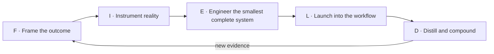

# Forward Deployed Engineer (FDE) Field Guide

[](https://creativecommons.org/licenses/by/4.0/)
[](README.zh-CN.md)
[](#how-to-use-this-guide)
[](https://github.com/Bosheng2020/fde-field-guide/actions/workflows/content-quality.yml)

**English** · [简体中文](README.zh-CN.md)

> ⭐ If this guide helps you ship production AI or prepare for an FDE role, star the repository to bookmark future updates.

**A bilingual, source-backed playbook for deploying AI and LLM systems—from ambiguous customer problems to safe, adopted, measurable production outcomes.**

## Forward-Deployed Engineering, in brief

A Forward-Deployed Engineer (FDE) turns an ambiguous, high-value customer problem into an adopted, measurable production system. The work spans discovery, technical scoping, system design, hands-on implementation, AI evaluation, production hardening, rollout, user adoption, and field-to-product learning.

This open, vendor-neutral guide covers Forward Deployed Engineer, Forward Deployment Engineer, Forward Deployed Software Engineer (FDSE), Applied AI Engineer, and adjacent deployment roles. It connects LLM deployment, AI agents, RAG, evaluation and observability, security and governance, post-training, production rollout, adoption, GTM, interview preparation, and a 30/60/90-day learning path. It combines first-party industry sources, reusable bilingual templates, illustrative deployment cases, and two original syntheses by **Bosheng Ding**: the FIELD Framework and the FDE Delivery Maturity Model.

> **Working definition:** A Forward-Deployed Engineer owns the path from an ambiguous, high-value customer problem to an adopted, measurable production system. The exact boundary varies by company.

Read the companion essay: [Beyond the Demo: What a Forward-Deployed Engineer Really Does](https://www.boshengding.com/blog/beyond-the-demo-forward-deployed-engineer).

_Last reviewed: 2026-10-22_

## Why this guide exists

“FDE” is used differently across companies. [Palantir](https://www.palantir.com/docs/foundry/architecture-center/overview), [OpenAI](https://openai.com/careers/forward-deployed-engineer-singapore-singapore/), [Anthropic](https://job-boards.greenhouse.io/anthropic/jobs/5423029008), and [Scale AI](https://scale.com/careers/4673310005) describe related patterns—engineers work close to customers and own real delivery—but their products, operating models, and role boundaries differ.

This guide separates three things that are often mixed together:

1. **Observed industry practice** — claims linked to first-party sources.
2. **Practical synthesis** — repeatable patterns inferred across deployments.
3. **Original frameworks** — clearly attributed tools for framing and running FDE work.

It is an independent educational project and is not affiliated with any company referenced here.

## Quick answers

### What is a Forward-Deployed Engineer?

A Forward-Deployed Engineer owns the path from an ambiguous customer problem to an adopted, measurable production system. The role combines problem framing, hands-on engineering, evaluation, rollout, user adoption, and converting field evidence into reusable product learning. See [FDE fundamentals](docs/en/01-fundamentals.md) for the sourced role map and its limits.

### How does an AI system move from demo to production?

This guide proposes the **FIELD** loop: Frame the outcome, Instrument reality, Engineer the smallest complete system, Launch into the workflow, and Distill field evidence into reusable learning. Each stage requires evidence; a polished demonstration alone does not establish production readiness or adoption.

### What counts as production-ready AI?

The original FDE Delivery Maturity Model distinguishes six evidence levels: L0 Demonstrable, L1 Useful, L2 Repeatable, L3 Operable, L4 Adopted, and L5 Compounding. For consequential deployments, this guide treats L3—monitoring, access control, runbooks, and rollback—as the minimum level for a production claim. L4 additionally requires sustained use and measurable outcome improvement.

### How should FDE success be measured?

FDE success requires evidence across four dimensions: system quality, user adoption, business impact, and organizational learning. A deployment is incomplete when it works technically but is not repeatedly used, or when it creates customer value without producing reusable product learning.

### When should an FDE use post-training?

Post-training should follow failure localization, not precede it. First determine whether the problem comes from model behavior, context, retrieval, data, tool contracts, orchestration, permissions, interface, or workflow design. Post-training becomes a strong candidate when the desired behavior is stable and measurable, suitable data exists, simpler interventions miss the target, and the lifecycle benefit justifies the added complexity.

For more concise answers and stable definitions, use the [FDE FAQ and glossary](docs/en/14-faq-glossary.md).

> The FIELD Framework and FDE Delivery Maturity Model are original syntheses by Bosheng Ding, not industry standards. For attribution, use [CITATION.cff](CITATION.cff).

## Start here

| If you want to… | Read / use |
|---|---|
| Understand the role | [FDE fundamentals](docs/en/01-fundamentals.md) |
| Compare FDE with adjacent roles | [Role map](docs/en/02-role-map.md) |
| Run an engagement end to end | [Deployment lifecycle](docs/en/03-deployment-lifecycle.md) |
| Assess or grow your capabilities | [Skills matrix](docs/en/04-skills-matrix.md) |
| Design an AI production system | [Architecture patterns](docs/en/05-architecture-patterns.md) |
| Build reliable evaluations | [Evaluation and observability](docs/en/06-evaluation-observability.md) |
| Manage safety and enterprise constraints | [Security and governance](docs/en/07-security-governance.md) |
| Drive adoption and commercial impact | [Adoption, GTM, and value](docs/en/08-adoption-gtm-value.md) |
| Avoid common failure modes | [Challenges and anti-patterns](docs/en/09-challenges-antipatterns.md) |
| Apply the original method | [The FIELD Framework](docs/en/10-field-framework.md) |
| Decide whether to post-train | [Post-training decision guide](docs/en/11-post-training.md) |
| Prepare for or hire into the role | [Career and interview guide](docs/en/12-career-interview.md) |
| Learn in 90 days | [30/60/90 learning path](docs/en/13-learning-path.md) |
| Get direct answers and stable definitions | [FDE FAQ and glossary](docs/en/14-faq-glossary.md) |
| Run a real project | [Ready-to-use templates](#ready-to-use-templates) |
| Study complete walkthroughs | [Illustrative deployment cases](examples/README.md) |
| Verify claims or explore tools | [Official sources](resources/official-sources.md) · [Open-source stack](resources/open-source-stack.md) |

## The FIELD Framework

**FIELD** is Bosheng Ding’s original synthesis for forward-deployed work. It is a feedback loop, not a waterfall.



| Stage | Core question | Primary evidence |
|---|---|---|
| **Frame** | What outcome, for whom, under which constraints? | Workflow map, baseline, success and failure criteria |
| **Instrument** | How will we know what works and why? | Evaluation set, traces, telemetry, error taxonomy |
| **Engineer** | What is the smallest complete system that can create evidence? | End-to-end production slice with controls |
| **Launch** | Will real users adopt it safely? | Usage, quality, operating metrics, runbook |
| **Distill** | What should improve for this and the next deployment? | Reusable primitives, product feedback, updated evals |

Read the full framework, deliverables, stage gates, and examples in [docs/en/10-field-framework.md](docs/en/10-field-framework.md).

## FDE Delivery Maturity Model

Also original to this guide, the maturity model prevents teams from calling a polished demo a deployment.

| Level | State | Minimum evidence |
|---|---|---|
| **L0 — Demonstrable** | Works in a curated scenario | Reproducible demo |
| **L1 — Useful** | Helps selected users complete a real task | User and task-quality evidence |
| **L2 — Repeatable** | Works across representative cases | Eval set, error taxonomy, stable workflow |
| **L3 — Operable** | Can run safely in production | Monitoring, access control, runbook, rollback |
| **L4 — Adopted** | Changes normal work and creates measurable value | Sustained usage and outcome improvement |
| **L5 — Compounding** | Improves the product and later deployments | Reusable components, product changes, growing eval assets |

## Repository map

```text
.
├── README.md / README.zh-CN.md       bilingual entry points
├── docs/en/                          14-chapter English field guide
├── docs/zh-CN/                       14 章中文实战手册
├── templates/                        bilingual delivery templates
├── examples/                         worked, fictional deployment cases
├── resources/                        official sources and open-source tools
└── .github/                          contribution and issue templates
```

## Ready-to-use templates

| Template | English | 中文 |
|---|---|---|
| Discovery and outcome canvas | [English discovery canvas](templates/discovery-canvas.md) | [中文需求发现画布](templates/discovery-canvas.zh-CN.md) |
| Evaluation plan | [English evaluation plan](templates/evaluation-plan.md) | [中文评估计划](templates/evaluation-plan.zh-CN.md) |
| Architecture and risk review | [English architecture review](templates/architecture-risk-review.md) | [中文架构与风险评审](templates/architecture-risk-review.zh-CN.md) |
| Production launch checklist | [English launch checklist](templates/launch-checklist.md) | [中文生产上线清单](templates/launch-checklist.zh-CN.md) |
| Field signal / product feedback | [English field-signal template](templates/field-signal.md) | [中文一线信号模板](templates/field-signal.zh-CN.md) |
| Deployment review | [English deployment review](templates/deployment-review.md) | [中文部署复盘](templates/deployment-review.zh-CN.md) |

## How to use this guide

- **Practitioners:** start with the lifecycle, then copy the templates into a live engagement.
- **AI engineers:** focus on architecture, evaluations, security, and the post-training decision guide.
- **Product and GTM leaders:** use the role map, adoption chapter, maturity model, and field-signal template.
- **Candidates:** use the skills matrix, learning path, interview guide, and worked examples to build evidence—not just talking points.
- **Hiring managers:** adapt the maturity model and skills matrix to define the actual outcomes your FDE team owns.

## Principles

1. **Outcome ownership over activity.** Shipping is necessary; changed operations are the goal.
2. **Workflow before model.** Start from the decision and constraint, not the newest capability.
3. **Evidence before scale.** Instrument, evaluate, and preserve rollback paths.
4. **Human control follows risk.** Autonomy is earned through evidence.
5. **Solve locally, learn globally.** A deployment should create customer value and reusable product leverage.
6. **Stop is a valid decision.** A well-evidenced “do not automate this” can be excellent FDE work.

## Authorship and attribution

The **FIELD Framework** and **FDE Delivery Maturity Model** are original syntheses by [Bosheng Ding](https://www.boshengding.com/). Industry descriptions and external methods are cited at the point of use and catalogued in [Official Sources](resources/official-sources.md).

If you build on the original frameworks, please attribute this repository or cite it using [CITATION.cff](CITATION.cff).

## Contributing

Corrections, field-tested patterns, counterexamples, regional perspectives, and translations are welcome. Please read [CONTRIBUTING.md](CONTRIBUTING.md). Claims about a named organization should use a first-party, publicly accessible source wherever possible.

## License

Except where otherwise noted, the written content and original diagrams are licensed under [Creative Commons Attribution 4.0 International](LICENSE). Code snippets are provided under the same terms for simplicity. External projects retain their own licenses.

