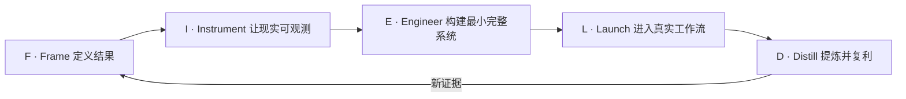

# Forward Deployed Engineer（FDE）实战手册｜前线部署工程

[](https://creativecommons.org/licenses/by/4.0/)
[](README.md)
[](#如何使用本手册)
[](https://github.com/Bosheng2020/fde-field-guide/actions/workflows/content-quality.yml)

[English](README.md) · **简体中文**

**一套中英文双语、有一手来源支持的 AI/LLM 部署手册：把模糊的客户问题推进为安全上线、真正采用且成果可衡量的生产系统。**

## 用一分钟理解 Forward-Deployed Engineering

Forward-Deployed Engineer（FDE）负责把一个模糊但高价值的客户问题，推进为真正被采用、成果可衡量的生产系统。工作通常横跨需求发现、技术范围定义、系统设计、亲手实现、AI 评测、生产加固、上线、用户采用，以及把一线证据转化为可复用产品能力。

这份开放、厂商中立的中英文手册涵盖 Forward Deployed Engineer、Forward Deployment Engineer、Forward Deployed Software Engineer（FDSE）、Applied AI Engineer 及相邻部署岗位，并连接大模型部署、AI Agent、RAG、评测与可观测性、安全与治理、后训练、生产上线、用户采用、GTM、面试准备和 30/60/90 天学习路线。内容包括一手行业资料、可复用的双语模板、完整的虚构部署案例，以及 **Bosheng Ding** 原创总结的 FIELD 框架和 FDE 交付成熟度模型。

> **工作定义：** FDE 负责把一个模糊但高价值的客户问题，推进为真正被采用、成果可衡量的生产系统。不同公司的具体职责边界并不完全相同。

延伸阅读：[Beyond the Demo：Forward-Deployed Engineer 如何把 AI 真正带入生产](https://www.boshengding.com/blog/beyond-the-demo-forward-deployed-engineer)。

_最近审阅：2026-10-22_

## 为什么需要这份手册

不同公司对 FDE 的定义并不完全相同。[Palantir](https://www.palantir.com/docs/foundry/architecture-center/overview)、[OpenAI](https://openai.com/careers/forward-deployed-engineer-singapore-singapore/)、[Anthropic](https://job-boards.greenhouse.io/anthropic/jobs/5423029008) 与 [Scale AI](https://scale.com/careers/4673310005) 描述了相近模式——工程师深入客户环境并对真实交付负责——但产品形态、团队结构和职责边界仍有显著差异。

本手册刻意区分三类内容：

1. **可观察的行业实践**：尽量引用公司官方的一手资料。
2. **实践总结**：从多类部署场景中提炼出的可复用模式。
3. **原创框架**：明确标注作者，用于组织和执行 FDE 工作。

这是独立教育项目，与文中提到的任何公司均无隶属或合作关系。

## 核心问题速答

### 什么是 Forward-Deployed Engineer？

FDE 负责把一个模糊但高价值的客户问题，推进为真正被采用、成果可衡量的生产系统。这个角色结合问题定义、亲手构建、评测、上线、用户采用，以及把一线证据转化为可复用产品能力。带来源的岗位地图及其适用边界见 [FDE 基础](docs/zh-CN/01-fundamentals.md)。

### AI 系统如何从 Demo 进入生产？

本手册提出 **FIELD** 闭环：定义结果（Frame）、让现实可观测（Instrument）、构建最小完整系统（Engineer）、进入真实工作流（Launch），再把一线证据提炼为可复用经验（Distill）。每个阶段都需要证据；包装精美的 Demo 本身不能证明系统已经具备生产能力或被用户采用。

### 什么才算生产级 AI？

原创 FDE 交付成熟度模型分为六级：L0 可演示、L1 有用、L2 可重复、L3 可运营、L4 被采用、L5 可复利。对于后果较大的部署，本手册把具备监控、权限控制、运行手册和回滚能力的 L3 视为声称进入生产的最低要求；L4 还需要持续使用和可衡量的结果改善。

### 如何衡量 FDE 项目是否成功？

FDE 项目需要同时提供四类证据：系统质量、用户采用、业务影响和组织学习。如果系统技术上可用却没有被持续使用，或者只解决单一客户问题却没有形成可复用的产品经验，交付仍不完整。

### FDE 应在什么时候使用后训练？

后训练应当发生在失败定位之后，而不是成为第一反应。团队应先判断问题来自模型行为、上下文、检索、数据、工具接口、编排、权限、界面还是工作流。只有当目标行为稳定且可衡量、存在合适数据、较简单方法无法达到目标，并且长期收益足以覆盖额外复杂度时，后训练才是强候选方案。

更多简明回答和稳定定义见 [FDE 常见问题与术语表](docs/zh-CN/14-faq-glossary.md)。

> FIELD 框架与 FDE 交付成熟度模型是 Bosheng Ding 的原创总结，并非行业标准。引用方式见 [CITATION.cff](CITATION.cff)。

## 从这里开始

| 如果你希望…… | 阅读 / 使用 |
|---|---|
| 理解 FDE 的本质 | [FDE 基础](docs/zh-CN/01-fundamentals.md) |
| 区分 FDE 与相邻岗位 | [岗位地图](docs/zh-CN/02-role-map.md) |
| 端到端执行一个项目 | [部署生命周期](docs/zh-CN/03-deployment-lifecycle.md) |
| 评估或提升个人能力 | [能力矩阵](docs/zh-CN/04-skills-matrix.md) |
| 设计 AI 生产系统 | [架构模式](docs/zh-CN/05-architecture-patterns.md) |
| 建立可靠评估体系 | [评估与可观测性](docs/zh-CN/06-evaluation-observability.md) |
| 处理安全与企业约束 | [安全与治理](docs/zh-CN/07-security-governance.md) |
| 推动采用和商业价值 | [采用、GTM 与价值](docs/zh-CN/08-adoption-gtm-value.md) |
| 避免常见失败模式 | [挑战与反模式](docs/zh-CN/09-challenges-antipatterns.md) |
| 使用原创方法论 | [FIELD 框架](docs/zh-CN/10-field-framework.md) |
| 判断是否需要后训练 | [后训练决策指南](docs/zh-CN/11-post-training.md) |
| 准备求职或招聘 | [职业与面试指南](docs/zh-CN/12-career-interview.md) |
| 用 90 天建立能力 | [30/60/90 天学习路径](docs/zh-CN/13-learning-path.md) |
| 获取直接答案和稳定定义 | [FDE 常见问题与术语表](docs/zh-CN/14-faq-glossary.md) |
| 直接开始真实项目 | [可直接使用的模板](#可直接使用的模板) |
| 阅读端到端完整案例 | [虚构部署案例](examples/README.md) |
| 核实资料或探索工具 | [官方资料](resources/official-sources.md) · [开源工具栈](resources/open-source-stack.md) |

## FIELD 原创框架

**FIELD** 是 Bosheng Ding 对 FDE 工作方式的原创总结。它是持续反馈的闭环，而不是瀑布式流程。



| 阶段 | 核心问题 | 主要证据 |
|---|---|---|
| **Frame** | 为谁、在什么约束下、改善什么结果？ | 工作流地图、基线、成功和失败标准 |
| **Instrument** | 如何判断系统有效，以及为什么有效？ | 评估集、Trace、监控和错误分类 |
| **Engineer** | 能产生真实证据的最小完整系统是什么？ | 带控制措施的端到端生产切片 |
| **Launch** | 真实用户能否安全采用？ | 使用、质量、运营指标和运行手册 |
| **Distill** | 如何改进当前项目并让下一次更快？ | 可复用组件、产品反馈和更新后的评估 |

完整阶段门、交付物和案例见 [FIELD 框架](docs/zh-CN/10-field-framework.md)。

## FDE 交付成熟度模型

该模型同样由本手册原创，用来避免把包装精美的 Demo 误称为生产部署。

| 等级 | 状态 | 最低证据 |
|---|---|---|
| **L0 — 可演示** | 在精选场景中可以运行 | 可重复 Demo |
| **L1 — 有用** | 帮助部分用户完成真实任务 | 用户反馈与任务质量证据 |
| **L2 — 可重复** | 在代表性案例中稳定工作 | 评估集、错误分类、稳定流程 |
| **L3 — 可运营** | 能够安全运行在生产环境 | 监控、权限、运行手册和回滚 |
| **L4 — 被采用** | 进入日常工作并创造可衡量价值 | 持续使用和结果改善 |
| **L5 — 可复利** | 改善产品以及后续部署 | 可复用组件、产品变化和增长的评估资产 |

## 仓库结构

```text
.
├── README.md / README.zh-CN.md       中英文入口
├── docs/en/                          14 章英文实战手册
├── docs/zh-CN/                       14 章中文实战手册
├── templates/                        双语交付模板
├── examples/                         完整的虚构部署案例
├── resources/                        官方资料与开源工具
└── .github/                          贡献和 Issue 模板
```

## 可直接使用的模板

| 模板 | 中文 | English |
|---|---|---|
| 需求发现与结果画布 | [中文需求发现画布](templates/discovery-canvas.zh-CN.md) | [English discovery canvas](templates/discovery-canvas.md) |
| 评估计划 | [中文评估计划](templates/evaluation-plan.zh-CN.md) | [English evaluation plan](templates/evaluation-plan.md) |
| 架构与风险评审 | [中文架构与风险评审](templates/architecture-risk-review.zh-CN.md) | [English architecture review](templates/architecture-risk-review.md) |
| 生产上线清单 | [中文生产上线清单](templates/launch-checklist.zh-CN.md) | [English launch checklist](templates/launch-checklist.md) |
| 一线信号 / 产品反馈 | [中文一线信号模板](templates/field-signal.zh-CN.md) | [English field-signal template](templates/field-signal.md) |
| 部署复盘 | [中文部署复盘](templates/deployment-review.zh-CN.md) | [English deployment review](templates/deployment-review.md) |

## 如何使用本手册

- **一线实践者：** 从部署生命周期开始，把模板复制进真实项目。
- **AI 工程师：** 重点阅读架构、评估、安全与后训练决策。
- **产品和 GTM 负责人：** 使用岗位地图、采用章节、成熟度模型与一线信号模板。
- **求职者：** 通过能力矩阵、学习路径、面试指南和完整案例建立“可展示的证据”，而不只是背概念。
- **招聘负责人：** 根据团队真正负责的结果改写能力矩阵和成熟度模型。

## 核心原则

1. **结果负责，而不是活动负责。** 上线只是必要条件，改变运营结果才是目标。
2. **先看工作流，再看模型。** 从决策和约束出发，而不是从最新能力出发。
3. **先有证据，再扩大规模。** 建立观测和评估，同时保留回滚路径。
4. **人工控制应与风险匹配。** 自主权需要由证据逐步赢得。
5. **解决一个具体问题，同时沉淀共性。** 部署应创造客户价值和产品杠杆。
6. **停止也可以是正确决策。** 有充分证据支持的“不应自动化”，同样是优秀的 FDE 工作。

## 作者与引用

**FIELD 框架**与 **FDE 交付成熟度模型**由 [Bosheng Ding](https://www.boshengding.com/) 原创总结。行业描述和外部方法在使用位置标注来源，并统一收录于[官方资料](resources/official-sources.md)。

如果你在自己的工作中扩展原创框架，请引用本仓库或使用 [CITATION.cff](CITATION.cff)。

## 参与贡献

欢迎提交事实修正、经过实践验证的方法、反例、不同地区的经验和翻译改进。详见 [CONTRIBUTING.zh-CN.md](CONTRIBUTING.zh-CN.md)。涉及具体公司的陈述，应尽量引用公开的一手官方资料。

## 许可协议

除特别注明外，文字内容和原创图表采用 [Creative Commons Attribution 4.0 International](LICENSE) 许可。为保持简单，代码片段也采用相同许可；外部项目仍适用各自的许可证。

