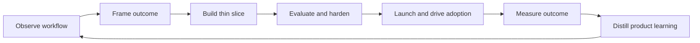

# What Is a Forward Deployed Engineer (FDE)?

**Language:** English · [简体中文](../zh-CN/01-fundamentals.md)  
**Content type:** Source-backed industry summary + author synthesis  
**Last reviewed:** 2026-10-22

## A working definition

A Forward-Deployed Engineer owns the path from an ambiguous, high-value customer problem to an adopted, measurable production system.

The center of gravity is **outcome ownership under real constraints**. An FDE typically moves across discovery, technical scoping, system design, implementation, evaluation, production rollout, adoption, and field-to-product learning. The precise boundary varies by company.

> **FDE = technical depth + product judgment + customer trust + ownership of real-world outcomes.**

## Why the role exists

Frontier technology does not enter an organization through an API call alone. Real workflows contain undocumented exceptions, fragmented data, permissions, legacy systems, conflicting stakeholders, safety requirements, and uncertain economics.

Three gaps create the need for forward deployment:

1. **Capability gap:** what the technology can do versus what the customer understands is possible.
2. **Context gap:** a general product versus the customer’s data, tools, policies, and workflow.
3. **Adoption gap:** a technically functional system versus a system people trust and repeatedly use.

An FDE closes all three without turning every engagement into permanent custom consulting.

## What an FDE produces

A healthy engagement creates two outputs:

### Customer outcome

- A useful end-to-end workflow in production.
- Evidence of quality, reliability, safety, adoption, and value.
- Clear ownership, operating procedures, and a path to scale or stop.

### Product leverage

- Reusable components and integration patterns.
- New evaluation cases and failure taxonomies.
- Structured product and research feedback.
- Better playbooks for the next deployment.

If the customer wins but nothing is reusable, the organization may have built a consulting business. If the platform learns but the customer never adopts, the deployment failed. Strong FDE work creates both.

## The operating loop

## What FDE is not

FDE is not automatically:

- a sales engineer who ends at technical validation;
- an implementation engineer executing a fixed specification;
- a consultant who hands off recommendations;
- a product engineer who never works inside the customer environment;
- an embedded contractor accepting every request;
- an AI demo builder optimizing for a single curated path.

It may overlap with all of these. The distinguishing question is: **who owns the complete transition from problem discovery to durable operating outcome?**

## AI changes the job, but not its essence

AI-focused FDEs must handle probabilistic behavior, rapidly changing model capability, evaluation data, tool use, human oversight, latency, and cost. Yet classic deployment concerns remain: identity, integration, data quality, process design, reliability, stakeholder alignment, and change management.

The model is one component of the production system. A strong FDE diagnoses whether a failure comes from the model, context, retrieval, data, tool contract, orchestration, permissions, interface, or operating process.

## A practical success test

Ask four questions:

1. **System quality:** does it perform reliably, safely, and economically?
2. **User adoption:** do the intended users repeatedly complete the workflow?
3. **Business impact:** did a meaningful operating outcome improve?
4. **Organizational learning:** did the deployment improve the product and future delivery?

The answers should be supported by evidence rather than a compelling demonstration.

## Source notes

- [OpenAI’s FDE role](https://openai.com/careers/forward-deployed-engineer-%28fde%29-sf-san-francisco/) describes ownership from discovery and scoping through build, rollout, adoption, measurable workflow impact, and eval-driven feedback.
- [Palantir’s careers catalogue](https://www.palantir.com/careers/open-positions/) shows the established family of forward-deployed software, infrastructure, reliability, security, and strategist roles.
- [Scale AI’s public-sector FDSE role](https://scale.com/careers/4481921005) emphasizes embedding with users and owning delivery from prototype to production.

See [Official Sources](../../resources/official-sources.md) for verification dates and additional context.

## Continue reading

- [Compare FDE with adjacent roles](02-role-map.md)
- [Follow the deployment lifecycle](03-deployment-lifecycle.md)
- [Use the FDE FAQ and glossary](14-faq-glossary.md)
- [Return to the field-guide index](../../README.md)

