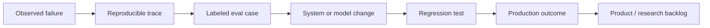

# Forward Deployed Engineering Lifecycle: Discovery to Production and Adoption

**Language:** English · [简体中文](../zh-CN/03-deployment-lifecycle.md)  
**Content type:** Practical playbook  
**Last reviewed:** 2026-10-22

The lifecycle is iterative. Stages provide decision gates, not a promise that discovery ends before engineering begins.

| Stage | Key decision | Minimum artifact | Exit evidence |
|---|---|---|---|
| 0. Qualify | Is this worth and safe enough to explore? | Opportunity brief | Sponsor, plausible value, access path |
| 1. Discover | What actually happens today? | Workflow map | Users, decisions, exceptions, baseline |
| 2. Frame | What exact outcome will we own? | Outcome contract | Scope, metric, failure boundary, non-goals |
| 3. Instrument | How will we evaluate reality? | Eval and telemetry plan | Representative cases and acceptance rules |
| 4. Engineer | Can a complete thin slice work? | Integrated vertical slice | Real data/tools, controls, traceability |
| 5. Pilot | Does it help under controlled real use? | Pilot report | Task quality, user feedback, failure taxonomy |
| 6. Harden | Can it operate safely and repeatedly? | Production readiness review | Security, reliability, runbook, rollback |
| 7. Launch | Will the workflow sustain adoption? | Rollout plan | Named owners, training, monitoring, support |
| 8. Scale / stop | Should scope expand? | Outcome review | Value, cost, risk, adoption trend |
| 9. Distill | What becomes reusable? | Field-learning brief | Product changes, evals, components, playbook |

## 0. Qualify the opportunity

Look for a meaningful workflow, an accountable sponsor, reachable users, accessible data or tools, and a result that can be observed. Disqualify projects whose only objective is “use AI,” or whose legal and security constraints make even a safe experiment impossible.

## 1. Discover the real workflow

Observe users rather than relying only on management descriptions. Map triggers, actors, decisions, systems, handoffs, queues, exceptions, approval paths, and failure costs. Measure the existing baseline even if imperfect.

Useful techniques:

- shadowing and artifact walkthroughs;
- “show me the last three cases” interviews;
- exception and escalation review;
- process and data lineage mapping;
- stakeholder and incentive mapping.

## 2. Frame an outcome contract

Define:

- target users and workflow step;
- baseline and desired change;
- in-scope and out-of-scope behavior;
- unacceptable failures;
- autonomy and human-approval boundary;
- owner, decision cadence, and target date;
- conditions for expanding, pausing, or stopping.

This is not a legal contract. It is a shared decision instrument.

## 3. Instrument before scaling

Build a representative evaluation set before optimizing a demo. Include common tasks, high-value cases, important edge cases, and unacceptable failures. Define product and business telemetry alongside model metrics.

## 4. Engineer a thin vertical slice

Build the smallest complete path through the real environment: identity, data, model, tools, interface, validation, logging, and human control. Mocking may help exploration, but the slice should replace its riskiest assumptions early.

## 5. Pilot with controlled users

Choose engaged users who represent the workflow, not only enthusiasts. Preserve comparison against the baseline. Record corrections, overrides, latency, cost, confusion, and where humans leave the system.

## 6. Harden for production

Complete a production-readiness review covering:

- identity, permissions, privacy, retention, and auditability;
- load, latency, availability, rate limits, and cost;
- retries, idempotency, fallbacks, timeouts, and rollback;
- eval regression, versioning, and change control;
- support ownership, incident severity, and escalation.

## 7. Launch into the operating model

Deployment is a change-management event. Train users on when to trust, verify, override, and escalate. Give managers visibility without creating surveillance. Assign operational ownership before the FDE steps back.

## 8. Scale, redesign, or stop

Expansion is earned. Compare value, usage, quality, cost, and risk with the original baseline. Scale a stable pattern; redesign a promising but blocked workflow; stop when evidence does not justify further investment.

## 9. Distill field learning

Turn anecdotes into assets:

Use the [field-signal template](../../templates/field-signal.md) and [deployment review](../../templates/deployment-review.md).

## Continue reading

- [Apply the FIELD Framework](10-field-framework.md)
- [Design evaluations and observability](06-evaluation-observability.md)
- [Use the production launch checklist](../../templates/launch-checklist.md)
- [Return to the field-guide index](../../README.md)

