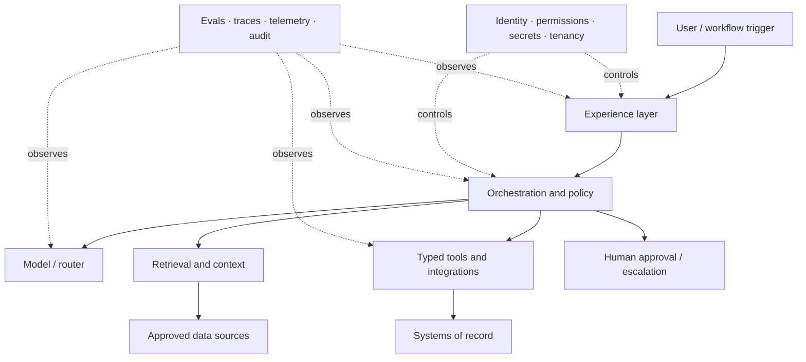
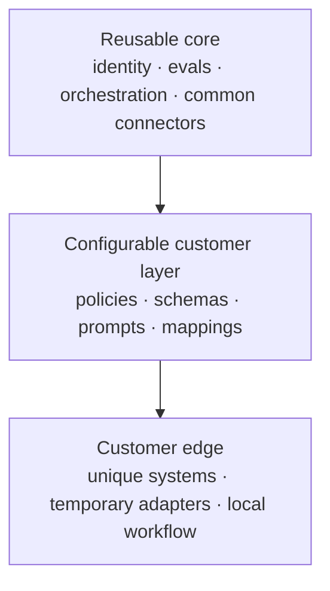

# AI Agent Architecture Patterns for Forward Deployed Engineers

**Language:** English · [简体中文](../zh-CN/05-architecture-patterns.md)  
**Content type:** Author synthesis and engineering playbook  
**Last reviewed:** 2026-10-22

There is no universal FDE architecture. The useful pattern is a **thin, observable, permissioned vertical slice** whose risky assumptions can be tested early.

## Reference architecture

The model does not own the architecture. The workflow, policy, tools, data, and controls define what the model may do.

## Design principles

### 1. Keep a deterministic shell around probabilistic behavior

Use ordinary code for permissions, calculations, schema validation, state transitions, hard policy, limits, and irreversible side effects. Use models where language understanding, synthesis, or flexible judgment is valuable.

### 2. Make tool contracts narrow and typed

Each tool should have:

- a single clear responsibility;
- validated inputs and outputs;
- least-privilege credentials;
- idempotency where retries are possible;
- explicit timeouts and error semantics;
- audit metadata;
- an approval requirement for consequential actions.

Tool descriptions are part of the system interface and should be evaluated like code.

### 3. Treat context as a governed data pipeline

Retrieval quality depends on source authority, freshness, permissions, chunking, metadata, ranking, and citation—not merely embeddings. Preserve the user’s access boundary during indexing and retrieval. Log which evidence supported each consequential answer.

### 4. Isolate changes

Version models, prompts, tool schemas, retrieval configuration, policies, and evaluation sets independently. Otherwise a regression cannot be attributed or rolled back safely.

### 5. Design failure and recovery first

Define what happens when a model times out, a tool partially succeeds, retrieved evidence conflicts, a human never approves, a downstream API is unavailable, or the cost limit is reached.

### 6. Prefer resumable workflows for long-running work

Persist state around external calls and approval points. Use queues or durable workflow systems when retries, hours-long waits, or exactly-once business effects matter. Do not keep critical state only in model context.

## Autonomy ladder

Autonomy should advance through evidence, not enthusiasm.

| Level | System behavior | Appropriate control |
|---|---|---|
| **A0 Observe** | Watches and records; no user-facing output | Data approval and privacy controls |
| **A1 Retrieve / explain** | Surfaces evidence and answers questions | Citations, access enforcement, user verification |
| **A2 Draft / recommend** | Produces a proposed decision or artifact | Human review before use |
| **A3 Act after approval** | Executes a prepared action only after explicit approval | Preview, approver identity, idempotency, audit |
| **A4 Bounded autonomy** | Acts within narrow limits and policies | Limits, monitoring, reversibility, exception queue |
| **A5 Exception oversight** | Handles a broad workflow; humans review exceptions | Strong evidence, mature operations, continuous audit |

Promotion depends on consequence, reversibility, detectability, permissions, and evaluation coverage. Model confidence alone is not a sufficient gate.

## Adaptation boundary

To balance bespoke delivery with product integrity, divide the system into three layers:

For every customer-specific element, record one decision:

- **upstream** into the reusable core;
- **configure** as a supported extension point;
- **own locally** with a named maintainer;
- **sunset** after migration or experiment.

The decision should consider recurrence across customers, strategic fit, security variance, performance needs, and maintenance burden.

## Common patterns

### Retrieval-assisted decision support

Use when users need current, permissioned evidence and retain decision responsibility. Return evidence, confidence/limitations, and a structured recommendation. This is often a safer first deployment than autonomous action.

### Tool-using workflow agent

Use when the process spans several systems and requires flexible sequencing. Keep tools narrow, state externalized, and high-impact actions behind approval until evidence supports more autonomy.

### Batch augmentation pipeline

Use for classification, extraction, enrichment, or triage over many items. It is easier to evaluate and roll back than an interactive agent, and may create the data needed for later automation.

### Human-review queue

Route uncertain, high-impact, or policy-sensitive cases to specialists. Capture the correction and reason as structured data. A review queue is an operating design, not a failure of automation.

### Model router with fallback

Choose models by task, data boundary, latency, quality, and cost. Make routing testable; define behavior when preferred models fail or become unavailable.

## Architecture review questions

1. Which exact user decision or action does the system support?
2. What must remain deterministic?
3. Which data and tools can each identity access?
4. What is the maximum safe autonomy level today?
5. Are side effects previewable, reversible, and idempotent?
6. Can every important decision be traced to context, policy, model, and tool versions?
7. What fails closed, what degrades, and what escalates?
8. Can we evaluate a change before production and detect regression after launch?
9. Who operates the system and owns incidents?
10. Which customer-specific parts will be upstreamed, configured, owned, or sunset?

Use the [architecture and risk review template](../../templates/architecture-risk-review.md).

## Continue reading

- [Evaluate LLM and agent systems](06-evaluation-observability.md)
- [Design production security and governance](07-security-governance.md)
- [Decide whether to post-train](11-post-training.md)
- [Return to the field-guide index](../../README.md)

