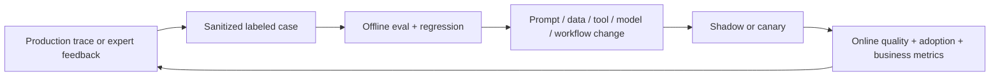

# Evaluation and Observability

**Language:** English · [简体中文](../zh-CN/06-evaluation-observability.md)  
**Content type:** Engineering playbook  
**Last reviewed:** 2026-10-22

Evaluation is not a final QA phase. It is the control system for deciding what to build, whether to launch, how much autonomy to allow, and whether a change improved reality.

## Evaluate at four levels

| Level | Question | Examples |
|---|---|---|
| Component | Does one part behave correctly? | Retrieval recall, extraction accuracy, schema validity, tool argument correctness |
| Trajectory | Did the system take an acceptable path? | Tool choice, policy compliance, loop behavior, evidence use, recovery |
| Task | Did the user’s task succeed? | Correct decision support, completed workflow, expert rating, intervention rate |
| Outcome | Did operations improve? | Cycle time, quality, cost, risk, conversion, adoption, expansion |

A high component score cannot compensate for a workflow nobody uses. A good business result also cannot excuse hidden safety failures.

## Build a representative evaluation set

Use a deliberate mixture:

- frequent ordinary cases;
- high-value or high-volume cases;
- difficult but legitimate edge cases;
- unacceptable failures and abuse cases;
- historical incidents and user corrections;
- cases across languages, roles, permissions, and data conditions;
- counterfactual cases where the correct behavior is refusal, escalation, or using no AI.

Record provenance, expected behavior, risk level, and why the case matters. Separate a development set from a held-out regression set.

## Define acceptance before optimization

For each dimension specify:

- metric or rubric;
- evaluator (deterministic, expert, model grader, production signal);
- threshold and confidence requirement;
- segment breakdown;
- unacceptable failure override;
- owner and response when the gate fails.

Do not collapse everything into one average. A 99% success rate may still hide a catastrophic 1% in a critical segment.

## Use multiple evaluator types

### Deterministic checks

Best for schema, permissions, exact calculations, allowed tools, citations, latency, cost, and policy conditions that can be encoded.

### Human/domain review

Necessary for nuanced quality, usefulness, and risk. Calibrate reviewers with examples; track disagreement rather than hiding it.

### Model-based graders

Useful for scalable semantic assessment when validated against human judgment. Use structured rubrics, blind comparisons where possible, and monitor grader drift. Never let the same unvalidated model be sole judge of its own high-risk output.

### Production signals

Usage, completion, edit distance, overrides, escalations, rework, abandonment, and downstream outcome often reveal problems offline evals miss.

## Observe the trace, not only the answer

For an agentic system, capture:

- request and user/tenant context without leaking unnecessary sensitive data;
- model, prompt, policy, retrieval, and tool versions;
- retrieved evidence and permission decisions;
- tool selection, arguments, response, latency, and error;
- state transitions, retries, fallbacks, approval, and escalation;
- final output, user correction, and outcome label;
- token/cost usage and end-to-end latency.

Sampling and redaction must respect privacy and retention policy.

## Error taxonomy

Use categories that map to fixes:

- problem/scoping error;
- missing or wrong context;
- retrieval or freshness error;
- model reasoning/generation error;
- tool selection or argument error;
- integration/permission failure;
- orchestration/state/recovery failure;
- policy/safety failure;
- UX or expectation failure;
- operating-process/adoption failure.

“The model was wrong” is usually too broad to guide action.

## Offline and online loop

## Example launch gates

These are starting points, not universal standards:

- zero known critical permission bypasses;
- every irreversible action requires approval at first launch;
- no regression on protected segments or unacceptable-failure tests;
- representative task quality meets the agreed threshold;
- latency and cost remain within operating budget;
- tracing, alerting, rollback, and an incident owner exist;
- pilot users complete the workflow and understand escalation.

## Common evaluation failures

- Testing only curated happy paths.
- Using synthetic data without checking production representativeness.
- Optimizing the grader rather than the user outcome.
- Reporting averages without segment and severity analysis.
- Changing model, prompt, retrieval, and tools simultaneously.
- Treating thumbs-up as sufficient business evidence.
- Logging traces nobody owns or reviews.
- Allowing evaluation data to become training data without a held-out set.

Use the [evaluation plan template](../../templates/evaluation-plan.md). Official OpenAI guidance on [agent evaluations](https://developers.openai.com/api/docs/guides/agent-evals) and [evaluation best practices](https://developers.openai.com/api/docs/guides/evaluation-best-practices) provides useful implementation detail; verify product lifecycle notices in [OpenAI deprecations](https://developers.openai.com/api/docs/deprecations) before choosing hosted tooling.

