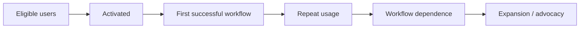

# Adoption, GTM, and Measurable Value

**Language:** English · [简体中文](../zh-CN/08-adoption-gtm-value.md)  
**Content type:** Customer delivery and commercialization playbook  
**Last reviewed:** 2026-10-22

Production deployment is incomplete until a useful system becomes normal work. Adoption is not a post-launch communications task; it is a product, workflow, incentive, and trust problem.

## Map the stakeholder system

| Stakeholder | What they need | Typical failure if ignored |
|---|---|---|
| Executive sponsor | Strategic result, risk visibility, credible milestones | Project loses protection or urgency becomes arbitrary |
| Workflow owner | Control, accountability, operating fit | No one owns the changed process |
| End user | Less friction, clear benefit, safe correction | Workarounds and abandonment |
| Domain expert | Fidelity, explainability, review authority | Low trust or unsafe acceptance criteria |
| Engineering / platform | Maintainability, interfaces, support boundary | Integration debt and operational conflict |
| Security / legal / GRC | Data, control, audit and risk evidence | Late-stage launch block |
| Product / research | Reproducible patterns and prioritized evidence | Field learning remains anecdotal |
| Commercial owner | Value narrative, scope and expansion signal | Overpromise, underprice, or misread success |

## Start with the workflow economics

Establish a baseline such as:

- time per case and queue delay;
- cost per completed task;
- error, rework, or escalation rate;
- revenue/conversion or avoided loss;
- expert capacity released;
- compliance or risk exposure;
- user experience and response time.

Then measure total deployment cost: model and infrastructure spend, integration and support time, human review, training, governance, and expected incident cost. ROI is a decision model, not a marketing percentage.

## Adoption funnel

Track where users drop and interview them. Low repeat usage may indicate poor quality, but it may also reflect missing permissions, wrong timing, an extra approval step, manager incentives, or a workflow that occurs infrequently.

## Trust is calibrated behavior

The goal is not maximum trust. Users should know:

- what the system is designed to do;
- which evidence supports an answer;
- what it cannot know;
- when review is required;
- how to correct, override, and escalate;
- what happens to their data and feedback.

Over-trust is as dangerous as under-adoption.

## Launch motion

1. Recruit representative champions, not only AI enthusiasts.
2. Train on the actual workflow and failure modes.
3. Start with a narrow cohort and visible support channel.
4. Review traces, corrections, and friction frequently.
5. Publish what changed because of user feedback.
6. Gradually expand users, cases, and autonomy separately.
7. Make the new operating owner explicit.

## FDE as part of GTM

FDE is not necessarily sales, but strong field work shapes go-to-market:

- reveals which use cases create urgent, repeatable value;
- produces reference architectures and proof backed by outcomes;
- distinguishes product gaps from enablement gaps;
- informs packaging, implementation cost, and realistic timelines;
- identifies expansion paths and disqualifying conditions;
- creates credible language for executives and practitioners.

The feedback must remain truthful. A strategic account does not make weak evidence stronger.

## Field-to-product signal

Convert a customer request into a structured signal:

- workflow and affected user;
- frequency and severity;
- reproducible trace or artifact;
- current workaround and impact;
- whether the pattern appears across customers;
- proposed product primitive, not only requested feature;
- evidence that the change improved the outcome.

Use the [field-signal template](../../templates/field-signal.md).

## Working across regions and on site

Many FDE roles require substantial travel; the percentage is specific to each employer and position. Effective field work requires cultural curiosity, preparation for local decision styles, clear written follow-up, and protection against knowledge remaining only with the traveler.

Before an on-site period, define decisions, access, users, and artifacts needed. Afterwards, publish a decision log, owners, evidence, risks, and next steps. Travel should compress feedback loops, not substitute for project structure.

## Expansion gate

Expand only when:

- the original workflow has a stable owner;
- repeat usage and task quality are sustained;
- business value exceeds the full operating cost;
- security and support scale with scope;
- the next cohort’s differences are understood;
- the core pattern is reusable rather than copied blindly.

Otherwise improve, redesign, or stop.

