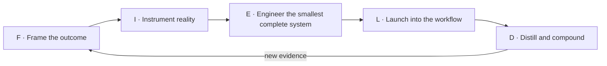

# The FIELD Framework

**Language:** English · [简体中文](../zh-CN/10-field-framework.md)  
**Content type:** Original framework + practical playbook  
**Last reviewed:** 2026-10-22

> **Attribution:** FIELD and the FDE Delivery Maturity Model are original syntheses by [Bosheng Ding](https://www.boshengding.com/). They are not industry standards. If you adapt them, please attribute this repository or use its `CITATION.cff`.

FIELD is an operating loop for turning an ambiguous opportunity into an adopted production outcome—and then turning field evidence into product leverage.

FIELD is **not** a waterfall. A failed evaluation may send the team from Engineer back to Frame; observed user behavior may send Launch back to Instrument. The stages exist to make decisions and evidence explicit.

| Stage | Decision | Minimum evidence |
|---|---|---|
| **Frame** | Is this the right outcome and scope? | Workflow, baseline, owner, constraints, success and failure criteria |
| **Instrument** | Can we tell whether the system works and why? | Representative cases, eval rules, traces, product and outcome telemetry |
| **Engineer** | Does the smallest complete system work in the real environment? | Integrated vertical slice with controls and tested failure paths |
| **Launch** | Can users adopt it safely and repeatedly? | Staged usage, quality, reliability, runbook, support ownership |
| **Distill** | What should improve here and become reusable elsewhere? | Updated evals, reusable primitives, product decisions, measured outcome |

## F — Frame the outcome

Start with the workflow and decision, not with a model or feature request.

### Questions

- Who performs the work today, and who owns the result?
- What triggers the workflow, and what decision or action ends it?
- Where do time, cost, quality, risk, or trust break down?
- What is the current baseline, even if it is imperfect?
- Which failure is unacceptable? Where must a human remain in control?
- What is explicitly outside scope?
- What evidence would justify expanding, redesigning, or stopping?

### Required artifacts

- A completed [discovery and outcome canvas](../../templates/discovery-canvas.md).
- A workflow map with systems, handoffs, exceptions, and approvals.
- A baseline and a small set of outcome metrics.
- A named sponsor, operational owner, and user cohort.
- A risk boundary and non-goals.

### Exit gate

Proceed when the team can state one accountable outcome in plain language, has access to representative users and data, and knows which result would cause it to stop. Do not proceed merely because a stakeholder wants “an AI agent.”

**Common trap:** converting a requested feature directly into a build plan without validating the underlying workflow.

## I — Instrument reality

Instrumentation turns opinions into evidence. It covers model behavior, system behavior, user behavior, and operating outcomes.

### Questions

- What representative cases cover normal work, high-value work, edge cases, and unacceptable failures?
- Which unit of work should be evaluated: a response, a tool action, a completed task, or the whole workflow?
- What must be traceable for debugging and audit?
- Which signals are available before launch, and which require real usage?
- What are the escalation and rollback conditions?

### Required artifacts

- An [evaluation plan](../../templates/evaluation-plan.md) with datasets, graders, thresholds, and owners.
- Trace and telemetry design covering model, tools, latency, cost, overrides, and outcomes.
- An error taxonomy that separates model, context, retrieval, tool, data, permission, interface, and process failures.
- Version identifiers for prompts, models, data, tools, and policies.

### Exit gate

Proceed when the team can reproduce important failures, compare a new version with a baseline, and explain how production regressions will be detected.

**Common trap:** measuring only API success or aggregate model accuracy while ignoring task completion and failure severity.

See [Evaluation and observability](06-evaluation-observability.md) for deeper methods.

## E — Engineer the smallest complete system

Build a thin vertical slice through the real environment. “Smallest” limits scope; “complete” means the critical path is real.

### Questions

- Which assumption is both uncertain and capable of invalidating the project?
- Which integrations, permissions, and data paths must be real now?
- Where should the system retry, degrade, refuse, request approval, or hand off?
- What is the simplest architecture that preserves observability and rollback?
- Is post-training needed, or can prompting, context, retrieval, tools, or workflow design solve the gap?

### Required artifacts

- An [architecture and risk review](../../templates/architecture-risk-review.md).
- A working end-to-end slice using representative data and tools.
- Automated tests for deterministic components and evaluation regression for probabilistic behavior.
- Access controls, audit events, fallbacks, timeouts, and human-review paths proportional to risk.
- A documented cost, latency, and reliability baseline.

### Exit gate

Proceed when the slice completes the intended task in the target environment, important failures are observable and controlled, and remaining limitations are explicit.

**Common trap:** polishing the happy path while mocking the integration or permission issue most likely to block production.

Use [Architecture patterns](05-architecture-patterns.md), [Security and governance](07-security-governance.md), and the [post-training decision guide](11-post-training.md).

## L — Launch into the workflow

Launch is a change to an operating system, not merely a software release.

### Questions

- Which users should enter first, and why are they representative?
- When should users trust, verify, override, or escalate?
- Who supports the system after the FDE steps back?
- How will adoption, quality, reliability, and outcome move together?
- What evidence permits greater autonomy or a larger cohort?

### Required artifacts

- A staged rollout and completed [production launch checklist](../../templates/launch-checklist.md).
- Training material and clear user expectations.
- A runbook with incidents, escalation, rollback, and ownership.
- A dashboard joining system health, task quality, adoption, and operating outcomes.
- A review cadence with users, sponsor, product, and engineering.

### Exit gate

Expand only when representative users repeatedly complete the workflow, risks remain within the agreed boundary, and outcome evidence improves relative to the baseline.

**Common trap:** treating sign-off or initial enthusiasm as adoption.

See [Adoption, GTM, and value](08-adoption-gtm-value.md).

## D — Distill and compound

The engagement should leave behind more than customer-specific code. Distillation converts field experience into durable organizational learning.

### Questions

- Which failures repeat, and what systemic cause connects them?
- Which capability belongs in the core product rather than in customer code?
- Which traces should become labeled evaluation cases?
- Which integration, policy, UI, or deployment pattern is reusable?
- Did the operating outcome justify the cost and risk?
- Should the project scale, redesign, remain bounded, or stop?

### Required artifacts

- A [deployment review](../../templates/deployment-review.md) comparing outcomes with the original baseline.
- One or more structured [field signals](../../templates/field-signal.md).
- New regression cases from observed failures.
- Reusable components, playbooks, or product requirements with owners.
- A documented scale, redesign, or stop decision.

### Exit gate

The loop is complete when both outputs exist: evidence of customer value and an owned path for reusable product learning. New evidence then starts the next Frame cycle.

**Common trap:** reporting anecdotes without reproducible traces, affected users, severity, or a proposed product decision.

## Worked example: an operations-review assistant

| FIELD stage | Example decision and evidence |
|---|---|
| **Frame** | Reduce analyst preparation time without allowing the system to approve an account change; baseline the current process. |
| **Instrument** | Create representative cases, label required evidence, record unsupported claims, tool errors, overrides, latency, and preparation time. |
| **Engineer** | Build a read-only slice that retrieves approved sources, drafts a recommendation, cites evidence, and requires analyst approval. |
| **Launch** | Pilot with a small representative cohort; train users to verify evidence and report missing context. |
| **Distill** | Add repeated failures to evals, promote the evidence-view component into the platform, and decide whether the next cohort is justified. |

The example is intentionally vendor-neutral. The relevant lesson is the sequence of decisions, not a particular model or stack.

## FDE Delivery Maturity Model

> **Attribution:** This maturity model is also an original synthesis by Bosheng Ding. It describes deployment evidence, not team prestige.

| Level | State | Minimum evidence | Next question |
|---|---|---|---|
| **L0 — Demonstrable** | Works in a curated scenario | Reproducible demo | Does it help on real work? |
| **L1 — Useful** | Helps selected users complete a real task | User and task-quality evidence | Is the behavior repeatable? |
| **L2 — Repeatable** | Works across representative cases | Eval set, error taxonomy, stable workflow | Can it be operated safely? |
| **L3 — Operable** | Can run safely in production | Monitoring, access control, runbook, rollback | Will users adopt it? |
| **L4 — Adopted** | Changes normal work and creates measurable value | Sustained usage and outcome improvement | Can the learning compound? |
| **L5 — Compounding** | Improves the product and later deployments | Reusable components, product changes, growing eval assets | Which new outcome should be framed? |

### How to use the levels

1. Record the current level and link to evidence; do not average dimensions into a decorative score.
2. Name the missing evidence for the next level.
3. Use the level to choose the next investment: more features are rarely the only answer.
4. Permit different workflows to sit at different levels.
5. Reassess after material changes to models, data, policies, integrations, or users.

For most consequential deployments, **L3 is the minimum production claim**, **L4 is the customer-outcome target**, and **L5 is the FDE organization’s compounding target**. A polished L0 demo should never be presented as an L4 outcome.

## FIELD review agenda

Use this 30-minute review weekly during an active engagement:

1. **Outcome:** what changed relative to the baseline?
2. **Evidence:** what new traces, evaluations, user behavior, or outcome data arrived?
3. **Failure:** which failure class is now the limiting constraint?
4. **Decision:** frame, instrument, engineer, launch, distill—or stop?
5. **Owner:** who produces which artifact before the next review?

## Continue reading

- [The forward-deployment lifecycle](03-deployment-lifecycle.md)
- [Evaluation and observability](06-evaluation-observability.md)
- [Challenges and anti-patterns](09-challenges-antipatterns.md)
- [Post-training decision guide](11-post-training.md)
- [30/60/90 learning path](13-learning-path.md)
