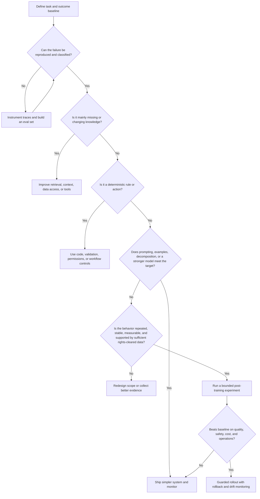

# Post-Training Decision Guide for FDEs

**Language:** English · [简体中文](../zh-CN/11-post-training.md)  
**Content type:** Technical decision guide  
**Last reviewed:** 2026-10-22

Post-training can create durable behavior for a repeated, well-defined task. It can also consume scarce data and engineering time while hiding a retrieval, tool, policy, or workflow problem. For an FDE, the first question is not “Which training method?” but **“What failure are we trying to change, and what is the least complex reliable intervention?”**

> **Principle:** Post-training is an optimization backed by evaluation evidence, not the default response to a disappointing demo.

## What counts as post-training here

This guide uses **post-training** broadly for techniques that update model weights after pretraining, including supervised fine-tuning, preference optimization, reinforcement learning, and related domain- or task-adaptation methods. Exact capabilities and terminology vary by model provider.

It distinguishes weight updates from:

- prompting and structured output constraints;
- context and instruction design;
- retrieval or memory;
- deterministic tools and validation;
- workflow decomposition and human approval;
- model selection, routing, or ensembling.

These interventions can be combined. The purpose of the guide is to locate the failure before choosing the mechanism.

## Decision sequence

## 1. Frame the task before the technique

Write down:

- the unit of work and intended user;
- baseline model and system configuration;
- representative input distribution;
- target behavior and unacceptable behavior;
- quality, safety, latency, cost, and adoption targets;
- expected frequency and lifetime of the task.

A behavior that changes weekly, occurs rarely, or cannot be evaluated consistently is usually a weak starting point for weight updates.

Use the [discovery and outcome canvas](../../templates/discovery-canvas.md) and the **Frame** stage of the [FIELD Framework](10-field-framework.md).

## 2. Localize the failure

| Observed failure | Likely first intervention | Why post-training may be the wrong first move |
|---|---|---|
| Missing current or private facts | Retrieval, data access, citations | Weights are a poor interface to frequently changing or permissioned knowledge |
| Wrong system action | Tool contract, schema, validation, permissions | Deterministic controls should enforce deterministic requirements |
| Long workflow loses state | Decomposition, orchestration, memory | The failure may sit outside the model’s local behavior |
| Inconsistent format | Structured output, validator, constrained decoding where available | Format can often be enforced more directly |
| Poor domain vocabulary or repeated task style | Prompted examples first; then consider supervised fine-tuning | Stable examples may support a weight-level adaptation |
| Preference or policy trade-off | Explicit rubric and eval; then consider preference optimization | The desired preference must be measurable before optimization |
| Weak reasoning on difficult cases | Better model, tools, decomposition, verifier, or bounded training experiment | Training cannot compensate for an unclear task or missing computation |
| Unsafe autonomy | Narrow scope, approval, policy checks, least privilege | Safety must be enforced at the system layer as well as model behavior |

Inspect traces end to end. A model-looking failure may originate in stale retrieval, truncated context, ambiguous instructions, incorrect tool output, or a broken permission path.

## 3. Exhaust the cheapest credible baseline

“Cheapest” means total system cost and risk, not only API price. Establish a credible baseline using an appropriate combination of:

1. clearer task definition and prompt;
2. representative few-shot examples;
3. structured outputs and validators;
4. retrieval and source citation;
5. deterministic tools;
6. workflow decomposition and human review;
7. a more capable or better-suited model;
8. routing between models or modes.

If a simpler system meets the target with acceptable economics and maintainability, post-training is unnecessary.

## 4. Check data readiness

Training data is a product asset, a governance object, and a model instruction. Before training, confirm:

- **Rights:** the organization is permitted to use the data for training and evaluation.
- **Privacy:** sensitive fields are removed, protected, or handled under an approved process.
- **Representativeness:** examples reflect real tasks, edge cases, languages, and user populations.
- **Quality:** labels express the intended behavior consistently.
- **Separation:** training, validation, and test sets do not leak cases or near-duplicates.
- **Coverage:** unacceptable failures and hard cases are visible, not filtered out.
- **Provenance:** examples, transformations, labelers, policies, and versions are traceable.
- **Refresh path:** the team knows how data and policy changes will be incorporated.

If these conditions are not met, improving the data system is usually more valuable than selecting a training algorithm.

## 5. Match the method to the behavior

| Desired change | Candidate approach | Evidence needed before choosing it |
|---|---|---|
| Stable response pattern, terminology, extraction, or task format | Supervised fine-tuning | Consistent high-quality demonstrations and task-level eval |
| Ranking among several acceptable responses | Preference optimization | Reliable comparisons or an explicit, validated preference rubric |
| Multi-step behavior with a measurable outcome or reward | Reinforcement-learning-style optimization | Reward validity, anti-gaming checks, safety constraints, stable environment |
| Domain distribution adaptation | Continued training or domain adaptation where supported | Strong corpus provenance, clear domain shift, capability-regression tests |
| Smaller or cheaper model approximating a stronger system | Distillation | Teacher quality, representative transfer set, latency/cost target, regression eval |

The table is a routing aid, not a guarantee. Provider support, data volume, compute, and governance constraints may rule out a method.

## 6. Evaluate the complete system

Use an [evaluation plan](../../templates/evaluation-plan.md) with frozen holdout cases and compare the post-trained candidate against the full baseline system—not against an intentionally weak prompt.

At minimum, review:

- task success and severity-weighted failure;
- safety and policy compliance;
- robustness across cohorts, languages, and edge cases relevant to the deployment;
- calibration, refusal, and human-escalation behavior;
- tool and retrieval interaction;
- latency, throughput, and total cost;
- regression on capabilities the workflow still needs;
- operational complexity, rollback, and provider dependency.

Document uncertainty. A small average gain can hide a critical regression in a high-risk slice.

## 7. Launch as a controlled change

Treat a weight update like a versioned production dependency.

Before rollout:

- register the model, dataset, code, rubric, and policy versions;
- define canary cohort and traffic allocation;
- preserve a known-good fallback;
- monitor distribution shift and key error classes;
- specify rollback authority and response time;
- update user guidance if behavior changes;
- complete the [production launch checklist](../../templates/launch-checklist.md).

Post-training does not remove the need for input validation, permissions, retrieval quality, output checks, human oversight, or incident response.

## When post-training is a strong candidate

The case becomes stronger when all of the following are true:

- the task is repeated frequently enough for the investment to compound;
- the target behavior is stable and expressible through examples or a reliable objective;
- the baseline failure is demonstrably model-behavior-related;
- simpler system changes do not meet the target;
- representative, rights-cleared data exists or can be produced responsibly;
- offline and online outcomes can be measured;
- the expected quality, latency, or cost benefit justifies lifecycle complexity;
- deployment includes monitoring, rollback, and future refresh ownership.

## Anti-patterns

- **Training before tracing:** optimizing weights before reproducing the failure.
- **Prompt strawman:** claiming a training win against an obviously weak baseline.
- **Evaluation leakage:** selecting examples or prompts using the final test set.
- **Data exhaust worship:** treating large volumes of logs as high-quality supervision.
- **Reward theater:** optimizing a proxy that users or models can game.
- **Safety by fine-tuning alone:** relying on behavior without system controls.
- **No rollback:** replacing the only production model without a fallback path.
- **Permanent experiment:** keeping a specialized model with no owner, refresh plan, or retirement rule.

## Minimum experiment packet

A bounded post-training proposal should include:

1. outcome and failure statement;
2. baseline system and error analysis;
3. data card with rights, provenance, distribution, and exclusions;
4. training method and hypothesis;
5. frozen evaluation plan and acceptance thresholds;
6. safety and regression plan;
7. cost and operational comparison;
8. canary, rollback, and ownership plan;
9. explicit ship, iterate, or stop decision.

This packet maps directly to **Instrument → Engineer → Launch → Distill** in the [FIELD Framework](10-field-framework.md).

## Continue reading

- [Architecture patterns](05-architecture-patterns.md)
- [Evaluation and observability](06-evaluation-observability.md)
- [Security and governance](07-security-governance.md)
- [Challenges and anti-patterns](09-challenges-antipatterns.md)
