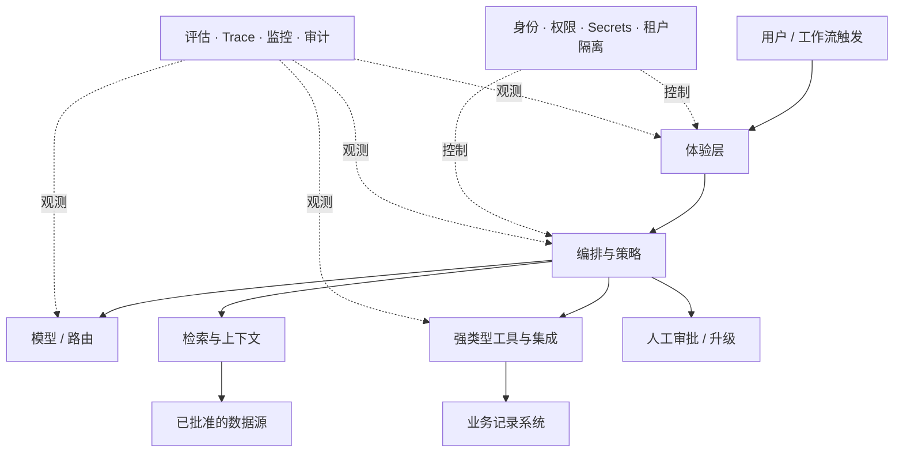
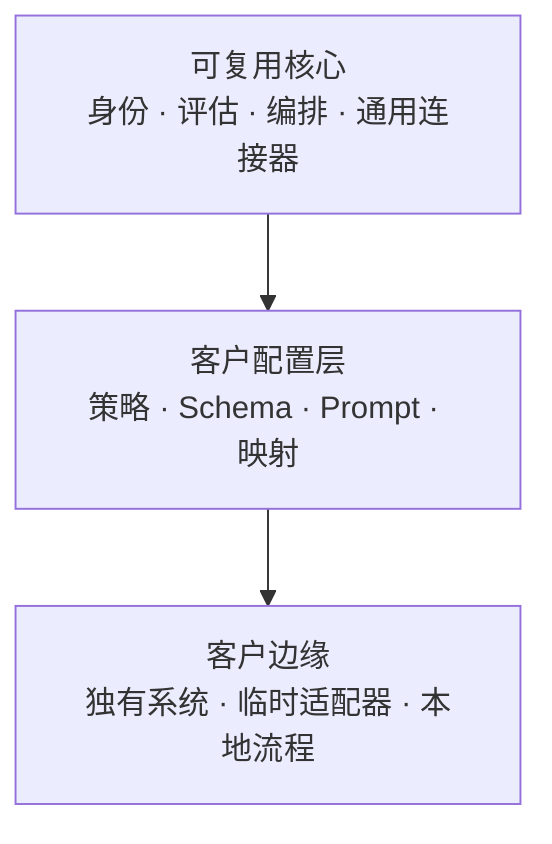

# FDE AI 系统架构模式

**语言：** [English](../en/05-architecture-patterns.md) · 简体中文  
**内容类型：** 作者总结与工程手册  
**最后检查：** 2026-10-22

不存在适用于所有 FDE 项目的架构。真正有用的模式是构建一个**小而完整、可观测、有权限控制的垂直切片**，并尽早验证风险最高的假设。

## 参考架构

模型不能决定系统架构。工作流、策略、工具、数据和控制共同定义模型可以做什么。

## 设计原则

### 1. 用确定性外壳包围概率性能力

权限、计算、Schema 验证、状态变化、强制政策、限制和不可逆副作用应使用普通程序；在语言理解、综合和灵活判断真正有价值时使用模型。

### 2. 工具接口应当窄且强类型

每个工具都应具备：

- 单一清晰职责；
- 经过验证的输入与输出；
- 最小权限凭据；
- 在可能重试时保持幂等；
- 明确超时和错误语义；
- 审计元数据；
- 对高影响操作要求审批。

工具描述是系统接口的一部分，也应像代码一样接受评估。

### 3. 把上下文当作受治理的数据管道

检索质量取决于来源权威性、新鲜度、权限、切分、元数据、排序和引用，而不只是 Embedding。索引和检索必须保留用户访问边界。对重要答案，应记录使用了哪些证据。

### 4. 隔离不同类型的变化

模型、Prompt、工具 Schema、检索配置、策略和评估集应分别版本化，否则无法定位回归或安全回滚。

### 5. 先设计失败和恢复

提前定义：模型超时、工具部分成功、检索证据冲突、人工一直未批准、下游 API 不可用或达到成本限制时，系统应该如何处理。

### 6. 长时间任务应支持恢复

在外部调用和审批点持久化状态。如果流程需要重试、等待数小时或保证业务副作用不重复，使用队列或持久化工作流系统。不要只把关键状态保存在模型上下文里。

## 自主程度阶梯

自主程度应由证据推动，而不是由热情推动。

| 等级 | 系统行为 | 合适控制 |
|---|---|---|
| **A0 观察** | 只观察和记录，不向用户输出 | 数据审批和隐私控制 |
| **A1 检索 / 解释** | 提供证据并回答问题 | 引用、访问控制、用户核验 |
| **A2 草拟 / 建议** | 生成建议或产物草稿 | 使用前由人工审核 |
| **A3 批准后行动** | 只有明确审批后才执行 | 预览、审批者身份、幂等和审计 |
| **A4 有界自主** | 在狭窄限制和策略内行动 | 限制、监控、可逆性和异常队列 |
| **A5 例外监督** | 处理较完整流程，人工只看例外 | 强证据、成熟运营和持续审计 |

升级应根据影响、可逆性、可检测性、权限和评估覆盖决定。模型置信度本身不足以作为升级门槛。

## 适配边界

为了平衡定制交付与产品完整性，把系统分为三层：

每个客户特定部分都必须做出一种决定：

- **上游合并**到可复用核心；
- **配置化**为受支持的扩展点；
- 由指定人员**本地维护**；
- 在迁移或实验结束后**下线**。

判断依据包括：是否在多个客户重复出现、战略匹配度、安全差异、性能需求和维护成本。

## 常见模式

### 检索增强的决策支持

适合用户需要最新、有权限的证据，同时保留最终决策责任的场景。返回证据、置信或限制说明，以及结构化建议。这通常比自动执行更适合第一次部署。

### 工具型工作流 Agent

适合跨多个系统、执行顺序需要灵活判断的流程。工具保持窄、状态外置；在证据足够之前，高影响操作必须审批。

### 批量增强管道

适合大量分类、抽取、补充或分流任务。与交互式 Agent 相比，它更容易评估和回滚，也可能为后续自动化创造数据。

### 人工审核队列

把不确定、高影响或政策敏感的案例交给专家，并结构化记录修正及原因。审核队列是一种运营设计，不代表自动化失败。

### 模型路由与降级

根据任务、数据边界、延迟、质量和成本选择模型。路由规则必须可测试，并定义首选模型失败或不可用时的行为。

## 架构评审问题

1. 系统具体支持用户的哪个决策或行动？
2. 哪些部分必须保持确定性？
3. 每种身份可以访问哪些数据和工具？
4. 当前最大安全自主等级是多少？
5. 副作用能否预览、撤销并保持幂等？
6. 每项重要决策能否追踪到上下文、策略、模型和工具版本？
7. 什么情况默认拒绝、什么降级、什么升级人工？
8. 能否在生产前评估变化，并在上线后发现回归？
9. 谁负责运营和事故？
10. 哪些客户特定部分会被上游合并、配置、本地维护或下线？

可直接使用[架构与风险评审模板](../../templates/architecture-risk-review.zh-CN.md)。

