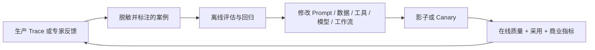

# 评估与可观测性

**语言：** [English](../en/06-evaluation-observability.md) · 简体中文  
**内容类型：** 工程实战手册  
**最后检查：** 2026-10-22

评估不是最后的 QA 阶段，而是决定“构建什么、是否上线、允许多大自主权，以及修改是否改善现实”的控制系统。

## 在四个层面进行评估

| 层面 | 核心问题 | 例子 |
|---|---|---|
| 组件 | 一个部分是否正确？ | 检索召回、抽取准确率、Schema 合法性、工具参数正确性 |
| 轨迹 | 系统是否采用可接受的路径？ | 工具选择、策略遵循、循环、证据使用、恢复 |
| 任务 | 用户任务是否成功？ | 正确决策支持、完成流程、专家评分、人工介入率 |
| 结果 | 运营是否改善？ | 周期、质量、成本、风险、转化、采用和扩展 |

组件得分再高，也不能弥补“工作流没人使用”；商业结果不错，也不能掩盖隐藏的安全失败。

## 建立代表性评估集

有意识地混合：

- 高频普通案例；
- 高价值或高流量案例；
- 困难但合法的边界案例；
- 不可接受的失败和滥用案例；
- 历史事故和用户修正；
- 不同语言、角色、权限和数据条件；
- 正确行为应是拒绝、升级人工或完全不用 AI 的反事实案例。

记录来源、期望行为、风险级别和案例价值。开发集与保留的回归集应分开。

## 优化前先定义验收

每个维度都要明确：

- 指标或评分标准；
- 评估者（确定性程序、专家、模型 Grader 或生产信号）；
- 阈值和置信要求；
- 分群分析；
- 不可接受失败的否决规则；
- 门槛失败后的负责人和处理动作。

不要把一切压缩成一个平均分。99% 成功率可能掩盖关键场景中灾难性的 1%。

## 组合多类评估者

### 确定性检查

适合 Schema、权限、精确计算、允许使用的工具、引用、延迟、成本，以及可以编码的强制政策。

### 人工 / 领域专家评审

细腻的质量、有用性和风险必须由人判断。用示例校准评审者，并追踪分歧，而不是隐藏分歧。

### 模型 Grader

在经过人工判断验证后，可用于规模化语义评估。使用结构化标准，尽量盲测，并监控 Grader 漂移。不要让未经验证的同一模型独自判断自己的高风险输出。

### 生产信号

使用、完成、编辑幅度、覆盖操作、升级、返工、放弃和下游结果，常常能发现离线评估看不到的问题。

## 不只观察最终答案，还要观察 Trace

Agent 系统应记录：

- 请求和用户/租户上下文，同时避免泄露不必要敏感数据；
- 模型、Prompt、策略、检索和工具版本；
- 检索证据和权限决策；
- 工具选择、参数、响应、延迟和错误；
- 状态变化、重试、降级、审批和升级；
- 最终输出、用户修正和结果标签；
- Token/成本及端到端延迟。

采样、脱敏和保留必须符合隐私政策。

## 错误分类

错误类别应直接对应修复手段：

- 问题定义 / 范围错误；
- 上下文缺失或错误；
- 检索或新鲜度错误；
- 模型推理 / 生成错误；
- 工具选择或参数错误；
- 集成 / 权限失败；
- 编排 / 状态 / 恢复失败；
- 政策 / 安全失败；
- UX 或预期错误；
- 运营流程 / 采用失败。

“模型错了”通常过于宽泛，无法指导行动。

## 离线与在线闭环

## 上线门槛示例

以下只是起点，不是统一标准：

- 不存在已知关键权限绕过；
- 首次上线时，所有不可逆操作都必须审批；
- 受保护人群和不可接受失败测试没有回归；
- 代表性任务质量达到约定阈值；
- 延迟和成本处于运营预算内；
- 具备 Trace、告警、回滚和事故负责人；
- 试点用户能够完成流程并理解升级方式。

## 常见评估失败

- 只测试精心挑选的顺利路径；
- 使用合成数据，却不检查其是否代表生产现实；
- 优化 Grader，而不是用户结果；
- 只报告平均值，不分析分群和严重度；
- 同时修改模型、Prompt、检索和工具；
- 把点赞当作充分商业证据；
- 记录了 Trace，却没有负责人审查；
- 把评估数据全部用于训练，没有保留独立集合。

可直接使用[评估计划模板](../../templates/evaluation-plan.zh-CN.md)。OpenAI 官方的 [Agent 评估指南](https://developers.openai.com/api/docs/guides/agent-evals)和[评估最佳实践](https://developers.openai.com/api/docs/guides/evaluation-best-practices)提供了实现细节；选择托管工具前，请检查 [OpenAI 产品弃用信息](https://developers.openai.com/api/docs/deprecations)。

