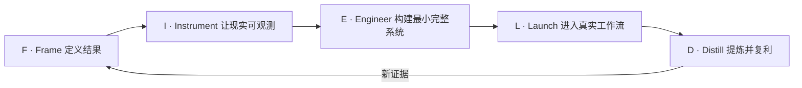

# FIELD 原创框架

**语言：** [English](../en/10-field-framework.md) · 简体中文  
**内容类型：** 原创框架 + 实战手册  
**最后检查：** 2026-10-22

> **作者与引用：** FIELD 与 FDE 交付成熟度模型均为 [Bosheng Ding](https://www.boshengding.com/) 的原创总结，并非行业标准。如果基于它们进行扩展，请注明本仓库或使用仓库中的 `CITATION.cff`。

FIELD 是一套将模糊机会推进为被采用的生产成果，并进一步把一线证据转化为产品杠杆的工作闭环。

FIELD **不是**瀑布式流程。评估失败可能让团队从 Engineer 回到 Frame；上线后观察到的用户行为也可能让 Launch 回到 Instrument。阶段的作用，是让决策和证据变得明确。

| 阶段 | 关键决策 | 最低证据 |
|---|---|---|
| **Frame** | 结果和范围是否正确？ | 工作流、基线、负责人、约束、成功与失败标准 |
| **Instrument** | 能否判断系统是否有效，以及为什么？ | 代表性案例、评估规则、Trace、产品与结果监控 |
| **Engineer** | 最小完整系统能否在真实环境中运行？ | 带控制措施、已测试失败路径的集成垂直切片 |
| **Launch** | 用户能否安全、持续地采用？ | 分阶段使用、质量、可靠性、运行手册、支持责任 |
| **Distill** | 当前项目如何改进，哪些经验可以复用？ | 更新后的评估、可复用能力、产品决策、结果证据 |

## F — Frame：定义结果

从工作流和决策出发，而不是从模型或功能请求出发。

### 关键问题

- 目前是谁在执行工作，谁对结果负责？
- 什么触发流程，最终以什么决策或行动结束？
- 时间、成本、质量、风险或信任具体损失在哪里？
- 当前基线是什么，即使它并不完美？
- 哪种失败不可接受？哪些步骤必须保留人工控制？
- 哪些内容明确不在范围内？
- 什么证据将支持扩大、重构或停止？

### 必要产物

- 完成的[需求发现与结果画布](../../templates/discovery-canvas.zh-CN.md)。
- 标注系统、交接、例外和审批的工作流地图。
- 当前基线与少量关键结果指标。
- 明确的发起人、运营负责人和用户群体。
- 风险边界与非目标。

### 退出门槛

只有当团队能够用清晰语言表达一个可负责的结果、能够接触代表性用户和数据，并知道什么结果将导致停止时，才应进入下一步。不能仅因为利益相关者提出“做一个 AI Agent”就开始构建。

**常见陷阱：** 未验证底层工作流，就把功能请求直接转换为开发计划。

## I — Instrument：让现实可观测

观测体系把观点转化为证据。它应同时覆盖模型行为、系统行为、用户行为和运营结果。

### 关键问题

- 哪些代表性案例覆盖日常、高价值、边界场景和不可接受的失败？
- 评估单位是什么：一条回复、一次工具行动、一个完整任务，还是整个工作流？
- 为了调试和审计，哪些决策必须能够追踪？
- 哪些信号可在上线前获得，哪些必须通过真实使用获得？
- 人工升级和回滚的触发条件是什么？

### 必要产物

- 包含数据集、评估器、阈值和负责人的[评估计划](../../templates/evaluation-plan.zh-CN.md)。
- 覆盖模型、工具、延迟、成本、人工覆盖和业务结果的 Trace 与监控设计。
- 区分模型、上下文、检索、工具、数据、权限、界面和流程的错误分类。
- Prompt、模型、数据、工具和策略的版本标识。

### 退出门槛

团队能够重复关键失败、将新版本与基线比较，并说明如何发现生产回归时，才能进入下一步。

**常见陷阱：** 只衡量 API 是否成功或模型平均准确率，而忽略任务是否完成以及失败严重程度。

深入方法见[评估与可观测性](06-evaluation-observability.md)。

## E — Engineer：构建最小完整系统

在真实环境中构建一条薄而完整的垂直切片。“最小”限制范围；“完整”意味着关键路径是真实的。

### 关键问题

- 哪个假设既不确定，又足以让整个项目失效？
- 哪些集成、权限和数据链路现在就必须真实？
- 系统应当在哪里重试、降级、拒绝、请求批准或转交人工？
- 哪种最简架构能够保留观测和回滚能力？
- 真的需要后训练吗？还是 Prompt、上下文、检索、工具或流程设计已经足够？

### 必要产物

- 完成的[架构与风险评审](../../templates/architecture-risk-review.zh-CN.md)。
- 使用代表性数据和工具的端到端切片。
- 针对确定性组件的自动化测试，以及针对概率行为的评估回归。
- 与风险匹配的权限、审计事件、降级、超时和人工审核路径。
- 已记录的成本、延迟和可靠性基线。

### 退出门槛

切片能够在目标环境完成预期任务，关键失败可以被观察和控制，其余限制被明确记录时，才能进入下一步。

**常见陷阱：** 精心打磨正常路径，却模拟了最可能阻止生产上线的集成或权限问题。

结合阅读[架构模式](05-architecture-patterns.md)、[安全与治理](07-security-governance.md)以及[后训练决策指南](11-post-training.md)。

## L — Launch：进入真实工作流

上线是对运营系统的改变，而不只是一次软件发布。

### 关键问题

- 哪些用户应当最先使用？他们为什么具有代表性？
- 用户什么时候可以信任、需要核验、应当覆盖或升级？
- FDE 逐步退出后，谁负责支持系统？
- 如何同时观察采用、质量、可靠性和业务结果？
- 什么证据允许扩大用户群或提高自主程度？

### 必要产物

- 分阶段上线方案和完成的[生产上线清单](../../templates/launch-checklist.zh-CN.md)。
- 用户培训材料与清晰的使用预期。
- 覆盖事故、升级、回滚和责任人的运行手册。
- 同时呈现系统健康、任务质量、采用情况和运营结果的看板。
- 用户、发起人、产品和工程共同参与的复盘节奏。

### 退出门槛

只有当代表性用户能够持续完成工作流、风险处于约定边界内，并且结果相较基线有所改善时，才应扩大范围。

**常见陷阱：** 把一次验收或初期热情当成持续采用。

详见[采用、GTM 与价值](08-adoption-gtm-value.md)。

## D — Distill：提炼并复利

项目不应只留下客户专用代码。提炼的作用，是把一线经验转化为长期组织能力。

### 关键问题

- 哪些失败反复出现？它们背后的系统性原因是什么？
- 哪些能力应进入核心产品，而不是留在客户代码中？
- 哪些 Trace 应转化为带标签的评估案例？
- 哪些集成、策略、界面或部署模式可以复用？
- 运营结果是否值得付出的成本和风险？
- 项目应扩大、重构、保持边界，还是停止？

### 必要产物

- 将结果与初始基线比较的[部署复盘](../../templates/deployment-review.zh-CN.md)。
- 一个或多个结构化的[一线信号](../../templates/field-signal.zh-CN.md)。
- 从真实失败转化而来的新回归案例。
- 明确负责人负责的可复用组件、手册或产品需求。
- 已记录的扩大、重构或停止决策。

### 退出门槛

同时形成客户价值证据和产品复用的责任路径后，这一轮才算完成。新的证据随后启动下一轮 Frame。

**常见陷阱：** 只报告故事，却没有可重复 Trace、受影响用户、严重程度或建议的产品决策。

## 示例：运营审核助手

| FIELD 阶段 | 示例决策与证据 |
|---|---|
| **Frame** | 在不允许系统直接批准账户变更的前提下，减少分析师准备时间，并记录当前基线。 |
| **Instrument** | 建立代表性案例，标注必需证据，记录无依据陈述、工具错误、人工覆盖、延迟和准备时间。 |
| **Engineer** | 构建只读切片：从批准的数据源检索、起草建议、引用证据，并要求分析师批准。 |
| **Launch** | 用小型代表性用户群试点，培训用户核验证据并报告缺失上下文。 |
| **Distill** | 将重复失败加入评估，把证据查看组件升级为平台能力，并决定是否扩大用户群。 |

该示例刻意保持厂商中立。重点是决策顺序，而不是特定模型或技术栈。

## FDE 交付成熟度模型

> **作者与引用：** 该成熟度模型同样是 Bosheng Ding 的原创总结。它描述的是部署证据，而不是团队地位。

| 等级 | 状态 | 最低证据 | 下一步问题 |
|---|---|---|---|
| **L0 — 可演示** | 在精选场景中可以运行 | 可重复 Demo | 它对真实工作有帮助吗？ |
| **L1 — 有用** | 帮助部分用户完成真实任务 | 用户与任务质量证据 | 行为能够稳定重复吗？ |
| **L2 — 可重复** | 在代表性案例中稳定工作 | 评估集、错误分类、稳定流程 | 能够安全运营吗？ |
| **L3 — 可运营** | 能够安全运行在生产环境 | 监控、权限、运行手册、回滚 | 用户会持续采用吗？ |
| **L4 — 被采用** | 改变日常工作并创造可衡量价值 | 持续使用和结果改善 | 经验可以形成复利吗？ |
| **L5 — 可复利** | 改善产品和后续部署 | 可复用组件、产品变化、增长的评估资产 | 下一步应定义什么结果？ |

### 如何使用等级

1. 记录当前等级，并链接到对应证据；不要把多个维度平均成装饰性分数。
2. 明确进入下一等级缺少什么证据。
3. 用等级选择下一项投资；增加功能很少是唯一答案。
4. 允许不同工作流处在不同等级。
5. 当模型、数据、策略、集成或用户发生重大变化时重新评估。

对于多数后果较大的部署，**L3 是声称进入生产的最低要求**，**L4 是客户结果目标**，而 **L5 是 FDE 组织的复利目标**。包装精美的 L0 Demo 绝不能被描述成 L4 成果。

## FIELD 每周复盘议程

活跃项目可以每周进行一次 30 分钟复盘：

1. **结果：** 相较基线发生了什么变化？
2. **证据：** 新增了哪些 Trace、评估、用户行为或结果数据？
3. **失败：** 当前限制系统的主要失败类别是什么？
4. **决策：** 下一步是定义、观测、构建、上线、提炼，还是停止？
5. **负责人：** 下次复盘前，谁负责产出什么材料？

## 继续阅读

- [前线部署生命周期](03-deployment-lifecycle.md)
- [评估与可观测性](06-evaluation-observability.md)
- [挑战与反模式](09-challenges-antipatterns.md)
- [后训练决策指南](11-post-training.md)
- [30/60/90 天学习路径](13-learning-path.md)
