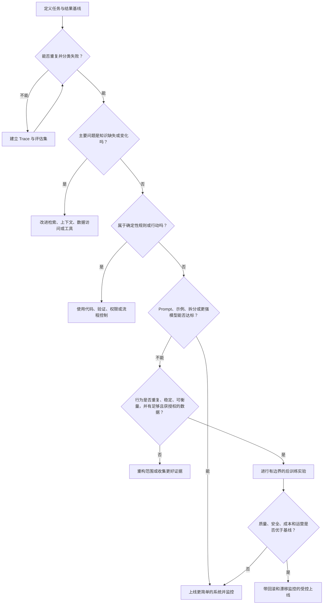

# Forward Deployed Engineer 后训练决策指南

**语言：** [English](../en/11-post-training.md) · 简体中文  
**内容类型：** 技术决策指南  
**最后检查：** 2026-10-22

后训练可以为重复、定义清晰的任务建立更稳定的模型行为，也可能消耗稀缺数据和工程资源，同时掩盖真正的检索、工具、策略或流程问题。对 FDE 而言，第一个问题不应是“选择哪种训练方法”，而应是：**“我们要改变的失败究竟是什么？什么是复杂度最低但足够可靠的干预方式？”**

> **原则：** 后训练应当是有评估证据支持的优化手段，而不是 Demo 表现不佳时的默认反应。

## 本文所说的后训练

本文用“后训练”统称预训练之后更新模型权重的技术，包括监督微调、偏好优化、强化学习，以及相关的领域或任务适配方法。具体能力和术语因模型供应商而异。

它与以下不更新权重的方法相区分：

- Prompt 与结构化输出约束；
- 上下文与指令设计；
- 检索或记忆；
- 确定性工具与验证；
- 工作流拆分与人工审批；
- 模型选择、路由或集成。

这些方法可以组合使用。决策的关键，是先定位失败，再选择机制。

## 决策顺序

## 1. 先定义任务，再选择技术

记录：

- 工作单位和目标用户；
- 基线模型与系统配置；
- 具有代表性的输入分布；
- 目标行为与不可接受行为；
- 质量、安全、延迟、成本和采用目标；
- 任务预计出现的频率与生命周期。

如果行为每周都在变化、发生频率很低，或无法稳定评估，通常不适合作为权重更新的起点。

可以使用[需求发现与结果画布](../../templates/discovery-canvas.zh-CN.md)，并参考 [FIELD 框架](10-field-framework.md)中的 **Frame** 阶段。

## 2. 定位失败

| 观察到的失败 | 优先尝试的干预 | 为什么后训练未必应当优先 |
|---|---|---|
| 缺少最新或私有事实 | 检索、数据访问、来源引用 | 权重不适合承载频繁变化或受权限控制的知识 |
| 执行错误的系统动作 | 工具契约、Schema、验证、权限 | 确定性要求应由确定性控制保证 |
| 长流程中丢失状态 | 任务拆分、编排、记忆 | 问题可能位于模型局部行为之外 |
| 输出格式不稳定 | 结构化输出、验证器、可用时采用约束解码 | 格式通常可以通过更直接的方式强制保证 |
| 领域术语或重复任务风格不佳 | 先用示例 Prompt，再考虑监督微调 | 稳定、高质量的示例可能支持权重级适配 |
| 偏好或策略权衡不符合要求 | 先建立明确 Rubric 和评估，再考虑偏好优化 | 优化前必须能够衡量所需偏好 |
| 困难案例推理较弱 | 更合适的模型、工具、拆分、验证器或有限训练实验 | 训练无法弥补模糊任务或缺失计算 |
| 自主行为风险过高 | 缩小范围、人工审批、策略检查、最小权限 | 安全既需要模型行为，也必须由系统层控制 |

需要检查完整 Trace。看似是模型的问题，可能来自过期检索、被截断的上下文、模糊指令、错误工具输出或损坏的权限链路。

## 3. 建立复杂度最低的可信基线

这里的“成本最低”指的是系统总成本和风险，而不只是 API 价格。可信基线可以组合使用：

1. 更清晰的任务定义和 Prompt；
2. 代表性的 Few-shot 示例；
3. 结构化输出与验证器；
4. 检索与来源引用；
5. 确定性工具；
6. 工作流拆分和人工审核；
7. 能力更强或更适合的模型；
8. 不同模型或模式之间的路由。

如果更简单的系统在经济性和可维护性可接受的前提下已经达标，就不需要后训练。

## 4. 检查数据准备度

训练数据既是产品资产，也是治理对象和对模型的指令。训练前应确认：

- **权利：** 组织有权将数据用于训练与评估。
- **隐私：** 敏感字段已删除、保护或按照批准流程处理。
- **代表性：** 示例覆盖真实任务、边界案例、语言和用户群体。
- **质量：** 标签对目标行为的表达一致。
- **隔离：** 训练、验证和测试集不存在案例或近重复内容泄漏。
- **覆盖：** 不可接受失败和困难案例没有被过滤掉。
- **来源：** 示例、转换、标注者、策略和版本均可追踪。
- **更新路径：** 团队知道数据和策略变化后如何更新。

如果这些条件尚未满足，改进数据系统通常比选择训练算法更有价值。

## 5. 让方法匹配目标行为

| 希望改变的行为 | 候选方法 | 选择前需要的证据 |
|---|---|---|
| 稳定的回答模式、术语、抽取或任务格式 | 监督微调 | 一致、高质量的示范数据和任务级评估 |
| 在多个可接受答案中排序 | 偏好优化 | 可靠的比较数据或经过验证的明确偏好 Rubric |
| 具有可衡量结果或奖励的多步行为 | 强化学习类优化 | 奖励有效性、防投机检查、安全约束和稳定环境 |
| 适应领域数据分布 | 在支持情况下进行持续训练或领域适配 | 可靠语料来源、明确分布变化、能力回归测试 |
| 用更小或更低成本模型近似强模型系统 | 蒸馏 | 教师系统质量、代表性迁移集、延迟/成本目标、回归评估 |

该表用于初步路由，并不保证效果。供应商能力、数据量、算力和治理条件都可能排除某种方法。

## 6. 评估完整系统

使用带冻结留出案例的[评估计划](../../templates/evaluation-plan.zh-CN.md)，并将后训练候选与完整基线系统比较，而不是与刻意设置得很弱的 Prompt 比较。

至少需要检查：

- 任务成功率和按严重程度加权的失败；
- 安全与策略遵循；
- 与部署相关的不同用户群、语言和边界案例鲁棒性；
- 校准、拒答和人工升级行为；
- 与工具和检索的交互；
- 延迟、吞吐与总成本；
- 工作流仍需能力上的回归；
- 运营复杂度、回滚和供应商依赖。

必须记录不确定性。平均指标的小幅提升，可能掩盖高风险分组中的严重退化。

## 7. 将上线视为受控变更

把权重更新视为一个有版本的生产依赖。

上线前：

- 登记模型、数据集、代码、Rubric 和策略版本；
- 定义 Canary 用户群和流量比例；
- 保留已知可靠的回退方案；
- 监控分布变化和关键错误类别；
- 明确回滚权限和响应时间；
- 如果行为发生变化，更新用户说明；
- 完成[生产上线清单](../../templates/launch-checklist.zh-CN.md)。

后训练不能取代输入验证、权限、检索质量、输出检查、人工监督和事故响应。

## 后训练适用性较强的条件

以下条件同时满足时，后训练的理由更充分：

- 任务重复频率足够高，投入能够复利；
- 目标行为稳定，可通过示例或可靠目标表达；
- 基线失败已被证明主要来自模型行为；
- 更简单的系统修改仍无法达到目标；
- 已有或能够负责任地获得代表性且获授权的数据；
- 离线和在线结果都可以衡量；
- 预期质量、延迟或成本收益足以抵消生命周期复杂度；
- 部署具备监控、回滚和未来更新负责人。

## 反模式

- **先训练、后追踪：** 尚未重复失败就开始优化权重。
- **Prompt 稻草人：** 用明显很弱的基线证明训练有效。
- **评估泄漏：** 使用最终测试集选择示例或 Prompt。
- **迷信日志规模：** 把大量日志直接等同于高质量监督数据。
- **奖励指标表演：** 优化容易被用户或模型投机的代理指标。
- **只靠微调保证安全：** 依赖模型行为而不建立系统控制。
- **没有回滚：** 替换唯一生产模型，却没有回退路径。
- **永久实验：** 专用模型没有负责人、更新计划或退役规则。

## 最小实验包

一个有边界的后训练提案至少应包含：

1. 结果与失败陈述；
2. 基线系统与错误分析；
3. 包含权利、来源、分布和排除项的数据说明；
4. 训练方法与假设；
5. 冻结的评估计划与验收阈值；
6. 安全与回归方案；
7. 成本和运营对比；
8. Canary、回滚和责任方案；
9. 明确的上线、迭代或停止决策。

该实验包可直接映射到 [FIELD 框架](10-field-framework.md)中的 **Instrument → Engineer → Launch → Distill**。

## 继续阅读

- [架构模式](05-architecture-patterns.md)
- [评估与可观测性](06-evaluation-observability.md)
- [安全与治理](07-security-governance.md)
- [挑战与反模式](09-challenges-antipatterns.md)
