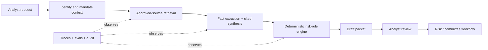

# Illustrative Case: Financial Research and Risk-Review Copilot

**Language:** English · [简体中文](financial-research-risk-copilot.zh-CN.md)  
**Type:** Illustrative—not a real customer claim  
**Purpose:** Show how FIELD changes an over-broad agent request into a controlled deployment

## Context and initial request

A small asset-management team asks for “an autonomous investment agent that reads the market and recommends trades.” The request sounds clear but combines research, judgment, risk control, execution, and accountability.

## F — Frame the outcome

Workflow observation shows that the bottleneck is not idea generation. Analysts spend significant time assembling approved evidence, normalizing company facts, checking whether a proposal violates mandate or exposure rules, and preparing material for an investment committee.

The first outcome contract becomes:

> Reduce preparation time for a research and risk-review packet while preserving analyst responsibility, source traceability, and independent approval.

**In scope:** retrieve approved sources, summarize evidence with citations, extract structured facts, compare a draft thesis with risk rules, and prepare a packet.  
**Out of scope:** autonomous trading, price prediction, final investment recommendation, or changing risk limits.  
**Autonomy:** A2 Draft / Recommend.

## I — Instrument reality

The team builds an evaluation set from previously completed packets, with sensitive information removed or retained only inside the authorized environment.

Evaluation dimensions:

- citation precision and support;
- factual extraction accuracy;
- correct risk-rule retrieval and application;
- distinction between fact, analyst assumption, and model inference;
- omission of unsupported claims;
- packet completeness and review time;
- unacceptable failure: inventing a source or silently passing a breached hard limit.

The existing manual workflow provides the baseline. Domain experts review outputs blindly against the historical packet where practical.

## E — Engineer the smallest complete system

Key choices:

- hard exposure and mandate rules stay deterministic;
- the model cannot call an execution venue;
- retrieved content is permission-filtered and cited;
- every fact stores source, timestamp, and extraction version;
- analysts can edit and label the reason;
- model, prompt, retrieval, and policy changes are versioned separately.

## L — Launch with controlled adoption

A representative pilot group uses the system on upcoming committee packets. A visible support channel and weekly error review keep the loop short. The team compares completion time, review effort, corrections, unsupported claims, and repeat use—not just model ratings.

The launch does not expand until:

- critical risk-rule tests pass;
- unsupported statements remain below the agreed threshold;
- analysts understand verification and escalation;
- the operating owner and rollback path are named.

## D — Distill and compound

Field evidence produces:

- a reusable permission-aware retrieval pattern;
- a risk-rule tool contract;
- an error taxonomy for cited research synthesis;
- new regression cases from analyst corrections;
- product requirements for evidence comparison and approval UX.

Only after repeated, stable semantic failures remain would the team consider post-training using expert corrections. It would preserve a held-out evaluation set and keep hard risk rules outside the model.

## Maturity assessment

- A curated packet generator is **L0 Demonstrable**.
- Real analysts completing packets is **L1 Useful**.
- Stable performance across representative cases is **L2 Repeatable**.
- Permissions, monitoring, runbook, and rollback make it **L3 Operable**.
- Sustained use and better operating metrics make it **L4 Adopted**.
- Reusable components and product changes create **L5 Compounding** value.

## Limitations

This example intentionally avoids performance numbers and regulatory claims. A real deployment would require jurisdiction-specific legal, compliance, market-data, recordkeeping, model-risk, and security review. The system supports professional workflow; it is not investment advice.

