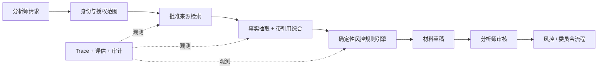

# 教学案例：金融研究与风控审核 Copilot

**语言：** [English](financial-research-risk-copilot.md) · 简体中文  
**类型：** 虚构教学案例，不代表真实客户  
**目的：** 展示 FIELD 如何把过度宽泛的 Agent 请求转化为受控部署

## 背景与最初请求

一家小型资产管理团队提出：“做一个自动阅读市场并推荐交易的投资 Agent。”这个请求看似清楚，却把研究、判断、风控、执行和责任混在一起。

## F — Frame：定义结果

观察工作流后发现，瓶颈并不是缺少投资想法，而是分析师需要花大量时间整理批准来源、标准化公司事实、检查方案是否违反授权或敞口规则，并准备投资委员会材料。

第一次结果约定改为：

> 在保留分析师责任、来源可追踪和独立审批的前提下，减少研究与风控材料的准备时间。

**范围内：** 检索批准来源、带引用总结证据、抽取结构化事实、把投资逻辑草稿与风控规则比较，并生成材料包。  
**范围外：** 自动交易、价格预测、最终投资建议或修改风险限额。  
**自主等级：** A2 草拟 / 建议。

## I — Instrument：让现实可观测

团队从历史材料建立评估集。敏感信息要么被移除，要么只保留在获授权环境中。

评估维度：

- 引用是否准确支持结论；
- 事实抽取准确性；
- 是否正确检索并应用风控规则；
- 是否区分事实、分析师假设和模型推断；
- 是否避免无依据陈述；
- 材料完整度和审核时间；
- 不可接受失败：编造来源，或悄悄放过违反硬性限额的方案。

现有人工流程作为基线。在可行时，由领域专家盲评系统输出与历史材料。

## E — Engineer：构建最小完整系统

关键选择：

- 硬性敞口和授权规则保持确定性；
- 模型无法调用交易执行系统；
- 检索内容经过权限过滤并带引用；
- 每项事实保存来源、时间和抽取版本；
- 分析师可以编辑并标注原因；
- 模型、Prompt、检索和策略分别版本化。

## L — Launch：受控上线

由能够代表真实用户的试点组处理即将提交的委员会材料。可见支持渠道和每周错误复盘缩短反馈周期。比较完成时间、审核工作量、修正、无依据陈述和重复使用，而不只是模型评分。

扩大范围前必须满足：

- 关键风控规则测试通过；
- 无依据陈述低于约定阈值；
- 分析师理解核验与升级方式；
- 明确运营负责人和回滚路径。

## D — Distill：提炼并复利

一线证据形成：

- 可复用的权限感知检索模式；
- 风控规则工具接口；
- 带引用研究总结的错误分类；
- 来自分析师修正的新回归案例；
- 证据比较和审批体验的产品需求。

只有当系统改进后仍存在重复、稳定的语义失败，团队才考虑使用专家修正做后训练。必须保留独立评估集，并让硬性风控规则继续位于模型之外。

## 成熟度判断

- 精选场景下的材料生成器是 **L0 可演示**；
- 真实分析师能完成材料是 **L1 有用**；
- 在代表性案例中稳定是 **L2 可重复**；
- 权限、监控、运行手册和回滚使其达到 **L3 可运营**；
- 持续使用并改善运营指标是 **L4 被采用**；
- 可复用组件和产品变化创造 **L5 可复利**价值。

## 局限

该案例刻意不提供绩效数字或监管结论。真实部署必须进行特定司法辖区的法律、合规、市场数据、记录保存、模型风险和安全审查。系统用于支持专业流程，不构成投资建议。

