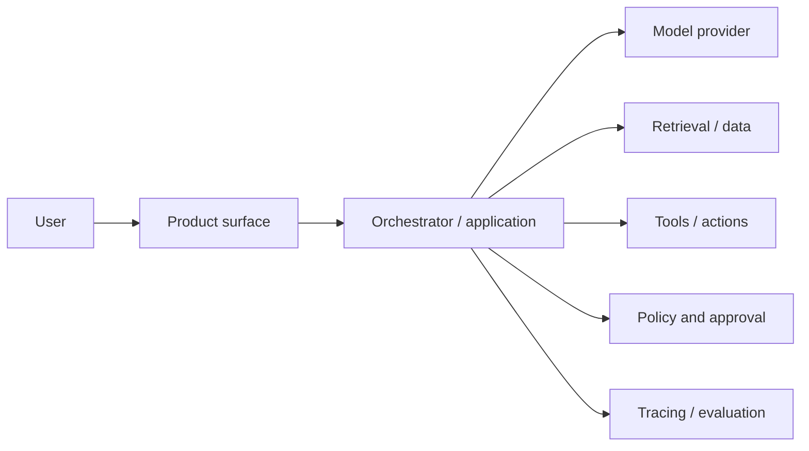

# Architecture and Risk Review

**Language:** English · [简体中文](architecture-risk-review.zh-CN.md)  
**Use:** Review the complete production path before a pilot handles real data or can create real-world side effects.

## 1. System and decision

| Field | Entry |
|---|---|
| System / release | |
| Architecture owner | |
| Security / privacy reviewer | |
| Operational owner | |
| Review date | |
| Proposed environment and user cohort | |
| Proposed autonomy level | L0 / L1 / L2 / L3 / L4 / L5 |

- **User outcome:** 
- **Consequential decisions or side effects:** 
- **Data classifications handled:** 
- **Regions / residency constraints:** 
- **Availability and recovery objective:** 

## 2. Context and trust boundaries

Replace the generic nodes with the actual system. Mark where identity, data ownership, or execution authority changes.

| Boundary / component | Owner | Authentication | Authorization | Data in / out | Logs / retention |
|---|---|---|---|---|---|
| User surface | | | | | |
| Application / orchestrator | | | | | |
| Model endpoint | | | | | |
| Retrieval / source systems | | | | | |
| Tools / write actions | | | | | |
| Observability / evaluation | | | | | |

## 3. Data and model controls

- [ ] Data minimization is applied before prompts, retrieval, logs, and evaluation stores.
- [ ] Tenant and user boundaries are enforced before retrieval—not only described in the prompt.
- [ ] Training, retention, residency, deletion, and subprocessors are documented for each provider.
- [ ] Secrets are stored outside prompts, source code, traces, and client-side bundles.
- [ ] Prompt injection and untrusted retrieved content are treated as data, not instructions.
- [ ] Model, prompt, tool, policy, and index versions are traceable for each run.
- [ ] Output schemas and consequential fields are validated deterministically.

| Data flow | Purpose | Lawful / approved basis | Minimum fields | Encryption | Retention / deletion | Owner |
|---|---|---|---|---|---|---|
| | | | | | | |

## 4. Tools, actions, and autonomy

| Tool / action | Permission scope | Side effect | Validation | Human approval | Idempotency / rollback | Rate / budget limit |
|---|---|---|---|---|---|---|
| | Read / Write / Execute | | | | | |

- **Default-deny behavior:** 
- **Policy engine or deterministic guard:** 
- **Approval identity and expiry:** 
- **Sandbox / isolation boundary:** 
- **Emergency disable mechanism:** 

## 5. Failure-mode and threat register

Score severity and likelihood before controls; state residual risk after controls. Detectability is separate—a severe failure that is hard to see deserves extra caution.

| Failure or threat | Cause / attack path | Severity | Likelihood | Detectability | Preventive control | Detection / response | Residual risk | Owner |
|---|---|---|---|---|---|---|---|---|
| Incorrect or fabricated output | | | | | | | | |
| Prompt injection / tool misuse | | | | | | | | |
| Unauthorized data exposure | | | | | | | | |
| Cross-tenant leakage | | | | | | | | |
| Excessive or irreversible action | | | | | | | | |
| Dependency / model outage | | | | | | | | |
| Silent quality drift | | | | | | | | |
| Cost or latency runaway | | | | | | | | |

## 6. Reliability and degradation

| Dependency | Timeout | Retry rule | Circuit breaker | Fallback | User-visible state | Owner |
|---|---:|---|---|---|---|---|
| | | | | | | |

- **Duplicate-event and idempotency strategy:** 
- **State recovery after partial execution:** 
- **Queue / concurrency / rate-limit behavior:** 
- **Graceful degradation path:** 
- **Backup and restore evidence:** 
- **Load and failure-injection evidence:** 

## 7. Observability and operations

- [ ] Traces connect user request, retrieval, model call, tool action, approval, and final outcome.
- [ ] Logs redact sensitive content while retaining enough evidence to investigate failures.
- [ ] Alerts map to an owner, severity, runbook, and escalation path.
- [ ] Quality, policy, cost, latency, and adoption can be sliced by relevant cohort.
- [ ] Rollback includes model, prompt, policy, index, application, and feature-flag changes.
- [ ] On-call ownership and customer communication responsibilities are explicit.

| Signal / SLO | Target | Alert threshold | Dashboard / runbook | Owner |
|---|---:|---:|---|---|
| | | | | |

## 8. Architecture decisions

| Decision | Alternatives considered | Evidence / trade-off | Revisit trigger | Owner / date |
|---|---|---|---|---|
| | | | | |

## 9. Review outcome

### Launch blockers

| Blocker | Required evidence or control | Owner | Due date |
|---|---|---|---|
| | | | |

### Decision

- [ ] Approved for the stated pilot scope.
- [ ] Conditionally approved; listed controls must be verified first.
- [ ] Redesign required.
- [ ] Not approved because residual risk exceeds expected value.

**Decision, accepted residual risks, approvers, and date:** 

