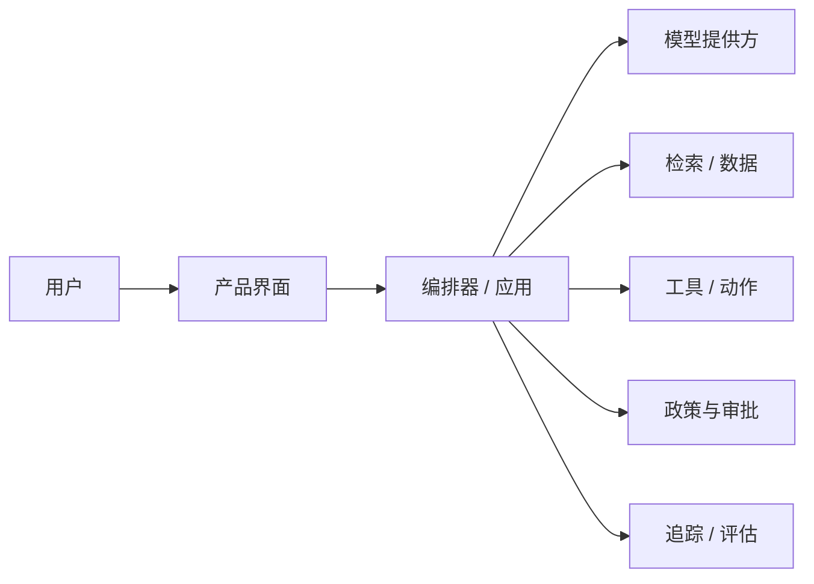

# 架构与风险评审

**语言：** [English](architecture-risk-review.md) · 简体中文  
**用法：** 在试点接触真实数据或能够产生现实副作用之前，评审完整的生产路径。

## 1. 系统与决策

| 字段 | 填写内容 |
|---|---|
| 系统 / 版本 | |
| 架构负责人 | |
| 安全 / 隐私评审人 | |
| 运营负责人 | |
| 评审日期 | |
| 建议环境与用户群 | |
| 建议自主等级 | L0 / L1 / L2 / L3 / L4 / L5 |

- **用户成果：** 
- **关键决策或现实副作用：** 
- **涉及的数据分级：** 
- **地区 / 数据驻留限制：** 
- **可用性与恢复目标：** 

## 2. 系统边界与信任边界

用真实系统替换下方通用节点，并标明身份、数据所有权或执行权限发生变化的位置。

| 边界 / 组件 | 负责人 | 身份认证 | 权限校验 | 输入 / 输出数据 | 日志 / 保留期限 |
|---|---|---|---|---|---|
| 用户界面 | | | | | |
| 应用 / 编排器 | | | | | |
| 模型端点 | | | | | |
| 检索 / 源系统 | | | | | |
| 工具 / 写操作 | | | | | |
| 可观测性 / 评估 | | | | | |

## 3. 数据与模型控制

- [ ] 在提示词、检索、日志和评估存储之前执行数据最小化。
- [ ] 在检索前强制执行租户和用户边界，而不只是将其写进提示词。
- [ ] 已记录各供应商的训练使用、保留期限、驻留、删除和分包商政策。
- [ ] 密钥不会出现在提示词、源代码、轨迹或客户端包中。
- [ ] 将提示注入和不受信任的检索内容视作数据，而不是指令。
- [ ] 每次运行均可追溯模型、提示词、工具、政策和索引版本。
- [ ] 使用确定性方法校验输出 Schema 和关键字段。

| 数据流 | 用途 | 合法 / 已批准依据 | 最少字段 | 加密 | 保留 / 删除 | 负责人 |
|---|---|---|---|---|---|---|
| | | | | | | |

## 4. 工具、动作与自主性

| 工具 / 动作 | 权限范围 | 副作用 | 校验 | 人工审批 | 幂等 / 回滚 | 频率 / 预算限制 |
|---|---|---|---|---|---|---|
| | 读取 / 写入 / 执行 | | | | | |

- **默认拒绝行为：** 
- **政策引擎或确定性防护：** 
- **审批身份与有效期：** 
- **沙箱 / 隔离边界：** 
- **紧急停用机制：** 

## 5. 失败模式与威胁登记表

先评估控制措施实施前的严重性和可能性，再说明剩余风险。可检测性需要单独衡量——严重且难以发现的失败应受到更严格的控制。

| 失败或威胁 | 原因 / 攻击路径 | 严重性 | 可能性 | 可检测性 | 预防控制 | 检测 / 响应 | 剩余风险 | 负责人 |
|---|---|---|---|---|---|---|---|---|
| 错误或捏造的输出 | | | | | | | | |
| 提示注入 / 工具滥用 | | | | | | | | |
| 未授权数据暴露 | | | | | | | | |
| 跨租户泄漏 | | | | | | | | |
| 过度或不可逆的动作 | | | | | | | | |
| 依赖项 / 模型中断 | | | | | | | | |
| 无告警的质量漂移 | | | | | | | | |
| 成本或延迟失控 | | | | | | | | |

## 6. 可靠性与降级

| 依赖项 | 超时 | 重试规则 | 熔断 | 降级方案 | 用户可见状态 | 负责人 |
|---|---:|---|---|---|---|---|
| | | | | | | |

- **重复事件与幂等策略：** 
- **部分执行后的状态恢复：** 
- **队列 / 并发 / 限流行为：** 
- **优雅降级路径：** 
- **备份与恢复证据：** 
- **负载与故障注入证据：** 

## 7. 可观测性与运维

- [ ] 轨迹能够关联用户请求、检索、模型调用、工具动作、审批和最终结果。
- [ ] 日志会脱敏敏感内容，同时保留足够的故障调查证据。
- [ ] 每个告警都有负责人、严重等级、运行手册和升级路径。
- [ ] 可按关键用户群或任务切片查看质量、政策、成本、延迟和采用情况。
- [ ] 回滚范围覆盖模型、提示词、政策、索引、应用和功能开关变更。
- [ ] 明确值班责任和面向客户的沟通责任。

| 信号 / SLO | 目标 | 告警阈值 | 仪表盘 / 运行手册 | 负责人 |
|---|---:|---:|---|---|
| | | | | |

## 8. 架构决策

| 决策 | 考虑过的替代方案 | 证据 / 取舍 | 重新评估触发条件 | 负责人 / 日期 |
|---|---|---|---|---|
| | | | | |

## 9. 评审结论

### 发布阻塞项

| 阻塞项 | 所需证据或控制 | 负责人 | 截止日期 |
|---|---|---|---|
| | | | |

### 决策

- [ ] 批准在所述试点范围内发布。
- [ ] 有条件批准；必须先验证列出的控制措施。
- [ ] 需要重新设计。
- [ ] 不批准；剩余风险高于预期价值。

**决策、已接受的剩余风险、批准人和日期：** 

